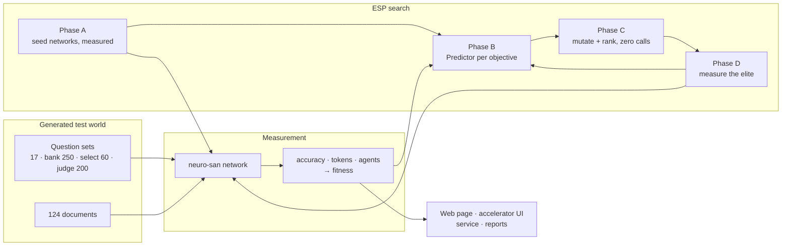

# neuro-san-esp

**A fitness function for [neuro-san](https://github.com/cognizant-ai-lab/neuro-san) agent
networks, and an evolutionary search that uses it.**

[](https://github.com/Sivakumarraj/neuro-san-esp/actions/workflows/ci.yml)
[](pyproject.toml)
[](LICENSE)

neuro-san's `agent_network_designer` turns a sentence into a working multi-agent network. It
builds **one** network and never measures it, and nothing in neuro-san or neuro-san-studio
scores one network against another. So there is no way to say whether a four-agent topology
beats a two-agent one for the same job, or which model each agent should run.

This project adds that missing half:

1. **Measure** any neuro-san network on questions with checkable answers: accuracy, tokens,
   dollars, model calls and agent count.
2. **Search** for a better network, using the surrogate-assisted structure of **ESP**
   (Evolutionary Surrogate-assisted Prescription): measure a few networks for real, train a
   Predictor on them, rank thousands of mutants for free, and pay only for the most promising.
3. **Serve** the winner: a browser page, neuro-san's accelerator UI, or a plain neuro-san
   registry.

There is no learned Prescriptor here, so this is not ESP in the paper's full sense. Prescription
is seven mutation operators plus Pareto-front selection. In shape it is nearer to **LEAF**
(*Evolutionary Neural AutoML for Deep Learning*, GECCO 2019), with agents where LEAF had layers.

## Headline result

On 100 questions it was never chosen on, asked twice, the network the search produced beat the
network neuro-san's designer builds:

| 100 judge questions × 2 repeats, search returns 10 documents | `2cc4`, Researcher on `gpt-5.4-mini` | Designer's shape, all `gpt-5.4-nano` |
| --- | --- | --- |
| Accuracy | **94.5%** (189/200; 91, then 98) | 84.0% (168/200; 82, then 86) |
| Tokens per question | **3,250** (−37%) | 5,153 |
| Cost per question | $0.00263 (+94%) | **$0.00135** |
| Cost per correct answer | $0.00278 (+72%) | **$0.00161** |
| Agents | **2** | 4 |

- **It is significant.** The evolved network was right more often on 17 questions against 2:
  sign test p = 0.0007.
- **Fewer tokens, more dollars.** It uses 37% fewer tokens, but its one document-reading agent
  runs a model 3.7× dearer per token, so each question costs 94% more. If cost matters more
  than the last few points of accuracy, use the router below.
- **It is not a pure structure result.** The designer's shape was not measured with its own
  specialists promoted, so how much of the gap is the topology and how much the stronger model
  is not separated.
- **It was chosen on different questions.** Every decision was made on the 60 `meridian-select`
  questions. The judge questions come from the other half of the generated company.
- **Where `2cc4` came from.** It is the hand-written `flat_pair` seed with its Arithmetic agent
  removed by the `remove_agent` operator: one mutation, chosen by measurement. The Predictor was
  not used in any paid run.

Cost is neuro-san's own count, at list prices. [docs/RESULTS.md](docs/RESULTS.md) has every
stage of the paid runs, how to reproduce them, and the earlier results, including the ones that
did not hold up. A test recomputes every figure in this README and in that page from the
committed logs in `results/headtohead/paid-2026-10/`.

## Routing each question: most of the accuracy for less money

The stronger network costs 94% more per question, and the designer's shape already answers
84% of the questions alone. `make route` trains a router on the select runs that sends a
question to the strong network only when its text predicts a gain, fixes its threshold on
select, and judges it once on judge. It runs on the committed logs, for $0.

| Judge, 100 questions × 2 | Accuracy | Cost per question |
| --- | --- | --- |
| Designer's shape alone | 84.0% | $0.00135 |
| **Router**, 40% of questions sent up | **93.0%** | **$0.00186** (29% less than the strong network) |
| The strong network alone | 94.5% | $0.00263 |

- **The router picks the right questions.** Sending the same 40% up at random scores 88.2%
  (p = 0.0005).
- **It does not beat a one-line rule.** "Two or more named entities, or an aggregate" keeps all
  94.5% at $0.00226. The router saves more and gives up 3 answers in 200.
- **This is ESP with a context.** The question is the context, the network is the action, and
  right answers and dollars are the outcomes. The prescription is a threshold, not a learned
  Prescriptor. [What it does not show](docs/FINDINGS.md#routing-each-question-to-a-network).

## How it works



- **A candidate is a neuro-san network.** Each one is an `agent_network_definition` plus a
  model per agent, so whatever the search produces runs as an ordinary neuro-san network.
- **The test world is generated.** Meridian Logistics has 24 depots, 40 contracts and 60
  incidents in 124 documents, invented so no model can answer from memory, with answers that
  are correct by construction. Search over it is a deterministic coded tool, so a score
  measures the topology, not a retrieval layer that drifts.
- **Fitness is a fixed formula over measured or predicted outcomes**, never learned:

  ```text
  fitness = accuracy − 0.06 · min(tokens / 300000, 1) − 0.02 · (agents / 9)
  ```

- **The Predictor is one gradient-boosted regressor per outcome** (accuracy, tokens), trained
  on thirteen structural features. An objective that does not beat its own permutation null is
  left out of the ranking; token cost currently does not.
- **Every paid run is capped and resumable.** A run stops at its dollar cap, appends every
  chunk to its log as it lands, and resumes where it stopped.

[docs/DESIGN.md](docs/DESIGN.md) explains every part: the genome, the seven operators, the
validity gate, what the Predictor is and is not, and the service.

## Quick start

Python 3.12+. Nothing in this section needs an account, a key, or a network.

```bash
python3.12 -m venv .venv && source .venv/bin/activate
pip install -e ".[dev]"

make validate    # lint, docs, HOCON validator, the full suite, an offline search
make offline     # phases B and C: breed and rank candidates, zero LLM calls
make route       # the per-question router, fitted on select, judged on judge
make holdout     # select on half the questions, judge on the other half
```

`make offline` trains the Predictor on the 12 committed measurements in
`tests/fixtures/cache/` and evolves against them.

### With a key

Runs on whichever provider's key is present in `.env` (`.env.example` lists them), chosen the
way neuro-san-studio chooses:

```bash
cp .env.example .env      # uncomment your provider's key line; .env is gitignored
make check-key            # asks the provider whether the key works
make smoke                # four questions to the served network, end to end
```

`make smoke` and the web page (`python apps/web/serve.py`) serve **`2cc4` with its Researcher
promoted**, at the 10 documents a search it was judged with. On a provider other than OpenAI
its models move rung for rung, and the page says that score has not been measured there.
`ESP_SERVE=fitness` serves the best network on the 17 built-in questions instead, which is what
a deployment running its own search wants.

To measure your own network, give it a HOCON path or manifest name and a JSON Lines file of
`{"question", "answer"}`:

```bash
make measure NETWORK=registries/my_network.hocon TASKS=my_questions.jsonl
```

A search needs a measured population first. There are two ways to get one. **They are
alternatives, not steps; run one, not both.**

```bash
make baseline             # A: measure the three seed networks on your provider
```

```bash
python scripts/adopt_measurements.py   # B: adopt the committed Gemini measurements
```

> **If a run ever reports `acc=0.00 tok=0 (cached)`**, an earlier run wrote zeros before the
> key worked. `tok=0` means no model was called. `rm -rf .esp-cache` and run the preflight
> again.

[docs/GUIDE.md](docs/GUIDE.md) covers providers and models, the preflight, what a run costs,
the web page, the accelerator UI, and running the optimizer as a service.

## Limitations

- **One task domain.** Every question comes from the same generated world, so what is measured
  is stability across questions, not transfer to a new domain.
- **One generation of search on the held-out run.** `2cc4` is the best of eight children of a
  hand-written seed, judged on 100 questions twice. A longer search and more repeats would
  tighten the error on the accuracy gap.
- **The paid result does not test the Predictor.** Every child in the paid search was measured;
  none was ranked by the Predictor first. Offline it picks the best of three unseen networks
  62% of the time against 33% by chance, which is level with simply picking the network with
  the most agents.
- **Shape is not the whole network.** Two children with the same shape scored 54 and 48 of 60
  on select because their instructions differ, and the Predictor sees only shape.
- **Few models measured.** The search ran on `gemini-3.1-flash-lite` and the head-to-heads on
  `gpt-5.4-nano`, with `gpt-5.4-mini` on one agent.
- **Model calls are recorded from now on.** Runs record neuro-san's count of model calls beside
  tokens, but every committed run predates that, so no call counts are quoted here.
- **Not novel as an idea.** AgentSquare (ICLR 2025) also uses a performance predictor to search
  agent designs. What is new here is doing it for neuro-san, which has no fitness function.

## Repository layout

| Path | What lives there |
| --- | --- |
| `esp/genome/` | The genome: neuro-san network definitions, the seven mutation operators, three seed networks |
| `esp/eval/` | The world, the question sets, the runner, the scorer, model failover |
| `esp/surrogate/` | The Predictor and its quality reporting |
| `esp/evolve/` | The ESP loop, the paid head-to-head, its networks and the held-out winner |
| `esp/service/` | The loop as an interruptible service, and the evaluator's tools |
| `esp/measure.py` | Measure any neuro-san network on any question file |
| `esp/route.py` | Route each question to the cheap or the strong network |
| `esp/report/` | The PDFs and the figures |
| `apps/web/` | The browser front end: ask the served network, measure networks |
| `apps/optimizer/` | One optimizer wake, runnable by hand or from any scheduler |
| `registries/` | neuro-san manifests for the optimizer and the evaluator |
| `scripts/` | Command-line entry points behind the make targets |
| `tests/` | The suite, and the committed measurements in `tests/fixtures/cache/` |
| `results/` | Paid-run logs, run history, held-out bank reports and figures |

## Testing

```bash
make validate      # lint, docs, HOCON validator, the full suite, an offline search
make verify        # a real neuro-san server firing the optimizer on its schedule
make figures       # every Predictor figure, regenerated from committed data
make cost-report   # every network in tokens and in dollars
make pool REHEARSE=1   # the paid pool benchmark end to end against a simulated provider, $0
```

The suite re-derives every question's answer from the documents, checks the registries against
contract tests, runs the experiment end to end against a fake provider, rebuilds the served
network and checks it is the one the logs measured, and fails if this README or
[docs/RESULTS.md](docs/RESULTS.md) disagrees with the committed measurements. CI runs the same
checks on Python 3.12 and 3.13. Transcripts of real runs are in `docs/proofs/`.

## Documentation

| | |
| --- | --- |
| [docs/REPORT.md](docs/REPORT.md) | How it works end to end, with diagrams and charts from the logs |
| [docs/RESULTS.md](docs/RESULTS.md) | Every measured result, the paid stages, and how to reproduce them |
| [docs/DESIGN.md](docs/DESIGN.md) | How the search works, part by part |
| [docs/GUIDE.md](docs/GUIDE.md) | Running it: providers, web page, accelerator UI, service |
| [docs/FINDINGS.md](docs/FINDINGS.md) | Measurements, failure analysis, prior art |
| [SERVING.md](SERVING.md) | Deployment, state, budget and the security model |
| [CONTRIBUTING.md](CONTRIBUTING.md) | Development setup and checks |
| [SECURITY.md](SECURITY.md) | Keys, the public page, dependencies, reporting a vulnerability |

**Older reports.** The PDFs in `docs/` were written before the held-out result, and this README
and [docs/RESULTS.md](docs/RESULTS.md) supersede them. The
[Beginner's guide](docs/neuro-san-esp-Beginner-Guide.pdf), the
[Primer](docs/neuro-san-esp-Primer.pdf) and the [Dossier](docs/neuro-san-esp-Dossier.pdf) were
written in September from the 17-question Gemini search. Their "0.94 against 0.82" is a score on
the questions the network was chosen on; on held-out questions that network tied the designer.
The [Paid runs](docs/neuro-san-esp-Paid-Runs.pdf) PDF covers stages 0 to 5 only. The Dossier
and the Paid runs PDF were built before the token correction, so their token and dollar figures
are twice the real ones; the Beginner's guide and the Primer are rebuilt with it.

Built on [neuro-san](https://github.com/cognizant-ai-lab/neuro-san) by Cognizant AI Lab.
Licensed under Apache 2.0.
