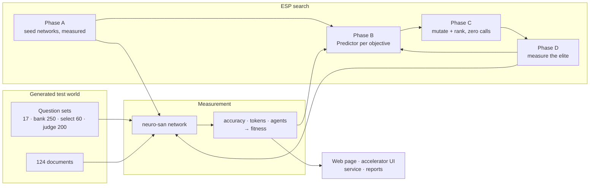

# neuro-san-esp

**A fitness function for [neuro-san](https://github.com/cognizant-ai-lab/neuro-san) agent
networks, and an evolutionary search that uses it.**

[](https://github.com/Sivakumarraj/neuro-san-esp/actions/workflows/ci.yml)
[](pyproject.toml)
[](LICENSE)

neuro-san's `agent_network_designer` turns a sentence into a working multi-agent network. It
builds **one** network and never measures it, and nothing in neuro-san or neuro-san-studio
scores one network against another. So there is no way to say whether a four-agent topology
beats a two-agent one for the same job, or which model each agent should run.

This project adds that missing half:

1. **Measure** any neuro-san network on questions with checkable answers: accuracy, tokens,
   dollars, model calls and agent count.
2. **Search** for a better network, using the surrogate-assisted structure of **ESP**
   (Evolutionary Surrogate-assisted Prescription): measure a few networks for real, train a
   Predictor on them, rank thousands of mutants for free, and pay only for the most promising.
3. **Serve** the winner: a browser page, neuro-san's accelerator UI, or a plain neuro-san
   registry.

The search has no learned Prescriptor, so it is not ESP in the paper's full sense. It prescribes
with seven mutation operators plus Pareto-front selection. In shape it is nearer to **LEAF**
(*Evolutionary Neural AutoML for Deep Learning*, GECCO 2019), with agents where LEAF had layers.
A learned Prescriptor is built for one decision, which of four measured networks answers each
question, and [it did not pass its test](#a-learned-prescriptor-question-by-question).

## Headline: better on all four at once

On the 100 judge questions it was never chosen on, asked twice at the same hour, `2cc4` with
its Researcher on `gpt-4o-mini` and a calculator on its Coordinator beat the designer's shape on
accuracy, tokens, cost and agents together, and so on fitness. The test and its five pass
marks were [pushed before it ran](docs/ALL-FOUR.md).

| 100 judge questions × 2, search returns 10 documents | `2cc4`, Researcher on `gpt-4o-mini`, Calculator | Designer's shape, all `gpt-5.4-nano` |
| --- | --- | --- |
| Accuracy | **93.5%** (187/200) | 80.3% (151/188) |
| Tokens per question | **3,344** (−37.1%) | 5,458 |
| Cost per question | **$0.00072** (−47.1%) | $0.00140 |
| Cost per correct answer | **$0.00077** | $0.00175 |
| Agents | **2** | 4 |
| Fitness, tokens / dollars | **+0.9192 / +0.9292** | +0.7757 / +0.7917 |

- **All five pass marks hold.** Right more often on 23 questions against 3: sign test
  p = 0.0001, +14.5 points with a 95% interval of +8.0 to +21.0. Fewer tokens in 23 of the 25
  four-question chunks (Wilcoxon p = 8.3e-07) and fewer dollars in all 25 (p = 6e-08).
- **Twelve of the designer's runs are missing, and they cannot change the verdict.** The key
  ran out of credit with 12 of the designer's 200 runs left, its second pass over J089 to
  J100. Counting all 12 as right and free of tokens and cost, the designer reaches 81.5% and
  every pass mark still holds (accuracy p = 0.0005).
- **Chosen on select, not on judge.** Three candidates answered the 60 select questions beside
  the designer's shape; this was the most accurate of those that were also leaner and cheaper
  there, at 93.3% against 75.0%. The calculator idea came from the wrong answers on judge and
  fresh, and [the plan](docs/ALL-FOUR.md) says so.
- **The two changes are not separated.** On select the calculator alone took `2cc4` to 91.7%
  and the `gpt-4o-mini` Researcher alone to 90.0%; only the pair was judged. Its near misses on
  judge, wrong numbers within ten times of the truth, fell from 20 runs on `2cc4` on nano to 2.
- **Fresh agrees on cost and leans the same way on accuracy.** On F01 to F40 the same afternoon
  it scored 88.8% against 75.0% with 27.8% fewer tokens (p = 0.014) and 41.3% less cost
  (p = 0.002); 9 questions against 4 is not significant on 40 questions (p = 0.2668).

`make all-four` recomputes all of it from the committed logs in `results/all-four/` for $0.
[docs/RESULTS.md](docs/RESULTS.md#better-on-all-four-at-once) has the select step and both
question sets.

## The most accurate network

On 100 questions it was never chosen on, asked twice, the network the search produced beat a
hand-written network in the shape neuro-san's designer builds:

| 100 judge questions × 2 repeats, search returns 10 documents | `2cc4`, Researcher on `gpt-5.4-mini` | Designer's shape, all `gpt-5.4-nano` |
| --- | --- | --- |
| Accuracy | **94.5%** (189/200; 91, then 98) | 84.0% (168/200; 82, then 86) |
| Tokens per question | **3,250** (−37%) | 5,153 |
| Cost per question | $0.00263 (+94%) | **$0.00135** |
| Cost per correct answer | $0.00278 (+72%) | **$0.00161** |
| Agents | **2** | 4 |

- **It is significant.** The evolved network was right more often on 17 questions against 2:
  sign test p = 0.0007.
- **Fewer tokens, more dollars.** It uses 37% fewer tokens, but its one document-reading agent
  runs a model 3.7× dearer per token, so each question costs 94% more. If cost matters more
  than the last few points of accuracy, use the router below.
- **It needs the stronger model on its Researcher.** With every agent of both networks on
  `gpt-5.4-nano`, `2cc4` scored 82.0% on these questions against 84.0%, a difference no test can
  tell from noise (p = 0.5034). Its two-agent shape makes it cheaper; the Researcher's model makes
  it more accurate. [Same model, half the agents](#same-model-half-the-agents) has that test.
- **It was chosen on different questions.** Every decision was made on the 60 `meridian-select`
  questions. The judge questions come from the other half of the generated company.
- **Where `2cc4` came from.** It is the hand-written `flat_pair` seed with its Arithmetic agent
  removed by the `remove_agent` operator: one mutation, chosen by measurement. The Predictor was
  not used in any paid run.

Cost is neuro-san's own count, at list prices. [docs/RESULTS.md](docs/RESULTS.md) has every
stage of the paid runs, how to reproduce them, and the earlier results, including the ones that
did not hold up. A test recomputes every figure in this README and in that page from the
committed logs in `results/headtohead/paid-2026-10/`.

## Replicated on 40 questions no network had seen, with a model control

The judge questions had been asked in earlier paid runs, and the headline mixed a change of
structure with a change of model. `make replicate` answers both: 40 new questions, F01 to F40
(`esp/eval/fresh.py`), twice each, of three networks. The third is the control: the designer's
shape with **every** specialist promoted to `gpt-5.4-mini`.

| 40 fresh questions × 2, 10 documents a search | `2cc4`, Researcher on mini | Designer's shape, specialists on mini (control) | Designer's shape, all nano |
| --- | --- | --- | --- |
| Accuracy | **90.0%** (72/80) | 77.5% (62/80) | 75.0% (60/80) |
| Tokens per question | **3,342** | 4,493 | 5,773 |
| Model calls per question | **5.62** | 7.39 | 7.47 |
| Cost per question | $0.00278 | $0.00340 | **$0.00153** |
| Cost per correct answer | $0.00309 | $0.00438 | **$0.00204** |
| Agents | **2** | 4 | 4 |

- **The headline replicates.** Against the designer's shape, `2cc4` was right more often on 9
  questions against 1 (p = 0.0215), with 42% fewer tokens and 25% fewer model calls.
- **The stronger model alone does not explain the gain.** Promoting all three specialists bought the designer's
  shape 2.5 points and more than doubled its cost. `2cc4` beat that control on 7 questions
  against 1 with 26% fewer tokens, 24% fewer model calls and 29% less per correct answer. On
  40 questions that gap is not significant at 0.05 (p = 0.0703). Nor does the shape alone
  explain it: [with the model held equal](#same-model-half-the-agents), neither set shows
  `2cc4` significantly more accurate.
- **The all-nano designer is still the cheapest.** `2cc4` costs 81% more a question and 51%
  more a correct answer. The trade is the same as in the headline: 15 points of accuracy for
  about $0.0012 a question.
- **The run cost $0.65** on the dollar cap's cautious count. Every chunk is committed in
  `results/replication/fresh-2026-10/`, and `tests/test_replication.py` recomputes each figure
  here from those logs. [Accuracy by kind of question](docs/RESULTS.md#replication-on-40-fresh-questions).

## Same model, half the agents

Is the two-agent shape better in itself? [docs/SAME-MODEL.md](docs/SAME-MODEL.md) fixed the test
and five pass marks and was pushed before the run: `2cc4` against the designer's shape with every
agent of both on `gpt-5.4-nano`, the 100 judge questions twice, both networks at the same hour.

| 100 judge questions × 2, every agent `gpt-5.4-nano`, 10 documents a search | `2cc4`, two agents | Designer's shape, four agents |
| --- | --- | --- |
| Accuracy | 82.0% (164/200) | **84.0%** (168/200) |
| Tokens per question | **4,596** (−14.6%) | 5,385 |
| Cost per question | **$0.00119** (−14.6%) | $0.00139 |
| Cost per correct answer | **$0.00145** | $0.00166 |
| Agents | **2** | 4 |

- **Cheaper, significantly.** Fewer tokens in 17 of the 25 four-question chunks (Wilcoxon
  p = 0.027) and fewer dollars in 18 (p = 0.0087).
- **Not more accurate, so the test fails.** Right more often on 8 questions against 12: sign
  test p = 0.5034, −2.0 points with a 95% interval of −7.5 to +3.5. The pass mark was a gain at
  p < 0.05. Fitness fails with it, because accuracy dominates the formula.
- **The fresh questions lean the other way, no more significantly.** On F01 to F40, the same day
  at the same settings, `2cc4` scored 80.0% against 70.0% (p = 0.2101) at about the same cost.
- **What it means.** The shape cuts tokens and cost by about 15% at no measurable loss of
  accuracy, and the headline's accuracy needs the stronger model on the Researcher. No network
  here is better than the designer's shape on accuracy, tokens and cost at once.
- **The measurement held.** The designer's shape scored 168/200 on judge, exactly what it scored
  in October, and `2cc4` with its Researcher promoted scored 87.5% on the fresh questions
  against 90.0% then.

`make same-model` recomputes this from the committed logs in `results/structure/` for $0;
[docs/RESULTS.md](docs/RESULTS.md#same-model-half-the-agents) has both question sets.

## Choosing the Researcher's model per question

The second test, [docs/MODEL-ROUTER.md](docs/MODEL-ROUTER.md), pushed before its judge outcome
was computed: `2cc4` with its Researcher on `gpt-5.4-nano` or `gpt-5.4-mini`, chosen question by
question by the router's Predictor, at no more cost a question than the designer's shape.

- **The router sends nothing up, so the test fails.** On select the budget allows 4 of the 60
  questions on mini. Mini beat nano on 6 select questions, and the Predictor ranks none of them
  first, so no threshold within budget beats sending nothing up. On judge the router is `2cc4`
  on nano: 82.0% against 84.0%, 14.6% cheaper.
- **The two networks could be more accurate at no more cost; the Predictor cannot find how.**
  Knowing every answer, sending up the 17 judge questions mini wins most, at $0.001384 a
  question against the designer's $0.001393, would score 94.5% against 84.0% (better on 18
  questions against 1, p = 0.0001). That is a bound computed on the questions it is reported on,
  not a result. What is missing is a signal, before a question is answered, of which questions
  need the stronger Researcher.
- **The headline held on the same day.** `2cc4` with its Researcher on mini scored 95.5%
  (191/200) on judge on 7 November at 3,020 tokens a question, against 94.5% in October.

`make model-router` recomputes this from the committed logs for $0;
[docs/RESULTS.md](docs/RESULTS.md#choosing-the-researchers-model-per-question) has the detail.

## A learned Prescriptor, question by question

The fourth test, [docs/PRESCRIPTOR.md](docs/PRESCRIPTOR.md), pushed before its judge outcome was
computed. ESP as its paper describes it, with both learned models: a Predictor per network, and
a neural Prescriptor evolved against it with NSGA-II to choose which of four measured networks
answers each question, within the designer's shape's cost a question.

- **The Prescriptor does not pass.** On judge it sends 34 questions to `2cc4` with its
  Researcher on `gpt-5.4-mini` and 66 to `c3`, the headline network, and scores 96.0% against
  93.5% for `c3` alone: right more often on 4 questions and less often on 1, p = 0.375, at
  77.6% more a question.
- **Its choice of questions cannot be told from chance.** The same shares handed out at random
  score 94.2% (p = 0.1235).
- **A second turn of the loop changed nothing.** With the judge outcomes added to the
  Predictor's training data, 160 questions, it scores 90.0% on fresh against 88.8% (better on 5
  questions, worse on 4, p = 1.0).
- **What it means.** `c3` is the cheapest of the four networks and within two points of the
  most accurate, so a choice per question has little to add, and five features of a question's
  text do not say which questions need the dearer network. Knowing every answer, the four
  networks answer every judge question at $0.00087 each. That is a bound, not a result.

`make prescriptor` recomputes this from the committed logs for $0;
[docs/RESULTS.md](docs/RESULTS.md#a-learned-prescriptor-question-by-question) has the detail.

## Routing each question: most of the accuracy for less money

The stronger network costs 94% more per question, and the designer's shape already answers
84% of the questions alone. `make route` trains a router on the select runs that sends a
question to the strong network only when its text predicts a gain, fixes its threshold on
select, and judges it once on judge. It runs on the committed logs, for $0.

| Judge, 100 questions × 2 | Accuracy | Cost per question |
| --- | --- | --- |
| Designer's shape alone | 84.0% | $0.00135 |
| **Router**, 40% of questions sent up | **93.0%** | **$0.00186** (29% less than the strong network) |
| The strong network alone | 94.5% | $0.00263 |

- **The router picks the right questions.** Sending the same 40% up at random scores 88.2%
  (p = 0.0005).
- **It does not beat a one-line rule.** "Two or more named entities, or an aggregate" keeps all
  94.5% at $0.00226. The router saves more and gives up 3 answers in 200.
- **This is ESP with a context.** The question is the context, the network is the action, and
  right answers and dollars are the outcomes. The prescription is a threshold, not a learned
  Prescriptor; a learned one is tried
  [above](#a-learned-prescriptor-question-by-question).
  [What it does not show](docs/FINDINGS.md#routing-each-question-to-a-network).

## Is the network sure? Agreement between two runs

HASSUM (Knowlton, Guha and Miikkulainen, 2026) samples an agent's reply several times and
escalates when the samples disagree in meaning. Every judge and fresh question was asked twice
of each network, so `make uncertainty` puts the same test to neuro-san networks from the
committed logs, for $0. Its beliefs are fitted on judge and checked on fresh.

| Designer's shape, all `gpt-5.4-nano` | Judge, 100 questions | Fresh, 40 questions |
| --- | --- | --- |
| Right when its two runs agree | **96.3%** (82 questions) | **96.7%** (30) |
| Right when they disagree | 27.8% (18) | 10.0% (10) |
| **Gate**: both runs, the strong network on disagreement | 92.5% at $0.00318 | 88.8% at $0.00376 |
| The one-line rule | **94.5%** at **$0.00226** | **90.0%** at **$0.00241** |

- **As a flag it works.** Disagreement marks the answers to check, on all three networks
  that ran twice. `2cc4`'s two runs agreed on 90 judge questions, and it was right on all 90.
- **As a gate it loses to the rule.** A gate pays for two cheap runs on every question, and
  two runs of the designer's shape cost more than one of `2cc4`. It would pay only if the
  cheap network cost less than 0.41 of the strong one; here it costs 0.515.
- **The rule already knows.** Every question the two runs disagreed on, 18 of 18 on judge and
  10 of 10 on fresh, is one the rule sends up anyway.
- **What is left to test is a cheaper probe.** Resampling one agent's reply inside the
  network, rather than the whole network, is what a neuro-san uncertainty middleware would
  do. Nothing here measured it.
  [The beliefs, the bounds and what this does not show](docs/FINDINGS.md#agreement-between-two-runs-a-flag-not-a-gate).

## Where the remaining errors are

One kind of question, charging several incidents at their contracts' penalty rates, is 16 of
the 140 judge and fresh questions. For the designer's shape it holds 30 of its 52 wrong runs,
and for `2cc4` 14 of its 19. `make autopsy` checks every wrong number against the generated world's
own hours and rates, for $0:

- **Not retrieval.** At most 2 of 60 wrong penalty runs are the sum of some incidents and not
  others, which is what a missed document gives. The rest are arithmetic over numbers the
  network had.
- **Both confident misses are one mistake.** J004 and F11, the answers the cheap network gave
  twice, are the difference of the two contracts' hourly rates: it found both contracts and
  never multiplied by the hours.

`make trace` (plan only; `GO=1` is about $0.07) asks both networks those questions again and
keeps every message every agent streams. neuro-san reports each agent's usage as it finishes,
so the trace shows which agent produced a wrong number and how a run's dollars split between
agents, which says what resampling only the front man's reply would cost.
[How the trace attributes usage](docs/FINDINGS.md#inside-a-run-the-penalty-questions).

## How it works



- **A candidate is a neuro-san network.** Each one is an `agent_network_definition` plus a
  model per agent, so whatever the search produces runs as an ordinary neuro-san network.
- **The test world is generated.** Meridian Logistics has 24 depots, 40 contracts and 60
  incidents in 124 documents, invented so no model can answer from memory, with answers that
  are correct by construction. Search over it is a deterministic coded tool, so a score
  measures the topology, not a retrieval layer that drifts.
- **Fitness is a fixed formula over measured or predicted outcomes**, never learned:

  ```text
  fitness = accuracy − 0.06 · min(tokens / 300000, 1) − 0.02 · (agents / 9)
  ```

- **The Predictor is one gradient-boosted regressor per outcome** (accuracy, tokens), trained
  on thirteen structural features. An objective that does not beat its own permutation null is
  left out of the ranking; token cost currently does not.
- **Every paid run is capped and resumable.** A run stops at its dollar cap, appends every
  chunk to its log as it lands, and resumes where it stopped.

[docs/DESIGN.md](docs/DESIGN.md) explains every part: the genome, the seven operators, the
validity gate, what the Predictor is and is not, and the service.

## Quick start

Python 3.12+. Nothing in this section needs an account, a key, or a network.

```bash
python3.12 -m venv .venv && source .venv/bin/activate
pip install -e ".[dev]"

make validate    # lint, docs, HOCON validator, the full suite, an offline search
make offline     # phases B and C: breed and rank candidates, zero LLM calls
make route       # the per-question router, fitted on select, judged on judge
make uncertainty # whether two runs agree, as a gate and as a flag, from the committed logs
make holdout     # select on half the questions, judge on the other half
```

`make offline` trains the Predictor on the 12 committed measurements in
`tests/fixtures/cache/` and evolves against them.

### With a key

Runs on whichever provider's key is present in `.env` (`.env.example` lists them), chosen the
way neuro-san-studio chooses:

```bash
cp .env.example .env      # uncomment your provider's key line; .env is gitignored
make check-key            # asks the provider whether the key works
make smoke                # four questions to the served network, end to end
```

`make smoke` and the web page (`python apps/web/serve.py`) serve **`2cc4` with its Researcher
promoted**, at the 10 documents a search it was judged with. On a provider other than OpenAI
its models move rung for rung, and the page says that score has not been measured there.
`ESP_SERVE=fitness` serves the best network on the 17 built-in questions instead, which is what
a deployment running its own search wants.

To measure your own network, give it a HOCON path or manifest name and a JSON Lines file of
`{"question", "answer"}`:

```bash
make measure NETWORK=registries/my_network.hocon TASKS=my_questions.jsonl
```

A search needs a measured population first. There are two ways to get one. **They are
alternatives, not steps; run one, not both.**

```bash
make baseline             # A: measure the three seed networks on your provider
```

```bash
python scripts/adopt_measurements.py   # B: adopt the committed Gemini measurements
```

> **If a run ever reports `acc=0.00 tok=0 (cached)`**, an earlier run wrote zeros before the
> key worked. `tok=0` means no model was called. `rm -rf .esp-cache` and run the preflight
> again.

[docs/GUIDE.md](docs/GUIDE.md) covers providers and models, the preflight, what a run costs,
the web page, the accelerator UI, and running the optimizer as a service.

## Limitations

- **One task domain.** Every question comes from the same generated world, so what is measured
  is stability across questions, not transfer to a new domain.
- **The baseline is the designer's shape, not its output.** `designer_shaped` is written by hand
  to the designer's rules (one coordinator, a specialist per kind of record). The networks
  neuro-san-studio's designer generates also carry its AAOSA instructions, which this one does
  not. A network the designer itself generated for these questions has not been measured.
- **One generation of search on the held-out run.** `2cc4` is the best of eight children of a
  hand-written seed, judged on 100 questions twice. A longer search and more repeats would
  tighten the error on the accuracy gap.
- **The paid result does not test the Predictor.** Every child in the paid search was measured;
  none was ranked by the Predictor first. Offline it picks the best of three unseen networks
  62% of the time against 33% by chance, which is level with simply picking the network with
  the most agents.
- **The learned Prescriptor did not earn its place.** Evolved against the Predictor to choose
  among four measured networks per question, it was not significantly more accurate than the
  best single network, and cost more ([docs/PRESCRIPTOR.md](docs/PRESCRIPTOR.md)). The networks
  themselves are still found by mutation and selection.
- **Shape is not the whole network.** Two children with the same shape scored 54 and 48 of 60
  on select because their instructions differ, and the Predictor sees only shape.
- **Few models measured.** The search ran on `gemini-3.1-flash-lite` and the head-to-heads on
  `gpt-5.4-nano`, with `gpt-5.4-mini` or `gpt-4o-mini` only on the agents that read documents.
- **One question world for the calculator too.** Its gain is on Meridian's totals and penalty
  sums; on questions with less arithmetic it would have less to fix.
- **A free Gemini key cannot fund a search.** The free tier caps requests per day for each
  model: 500 on the flash-lite models, and about 20 on `gemini-3.5-flash`. A candidate costs
  about 165 requests, so a day buys three flash-lite candidates and not one on the stronger
  model. That is why the Gemini search is one generation deep
  ([FINDINGS.md](docs/FINDINGS.md)).
- **Model calls are counted only in the replication.** Runs record neuro-san's count of model
  calls beside tokens, but every run before the replication predates that.
- **40 fresh questions.** The replication beats the designer's shape significantly, but its
  edge over the model control (7 questions against 1) needs more questions to be significant.
- **Not novel as an idea.** AgentSquare (ICLR 2025) also uses a performance predictor to search
  agent designs. What is new here is doing it for neuro-san, which has no fitness function.

## Repository layout

| Path | What lives there |
| --- | --- |
| `esp/genome/` | The genome: neuro-san network definitions, the seven mutation operators, three seed networks |
| `esp/eval/` | The world, the question sets, the runner, the scorer, model failover |
| `esp/surrogate/` | The Predictor and its quality reporting |
| `esp/evolve/` | The ESP loop, the paid head-to-head, its networks and the held-out winner |
| `esp/service/` | The loop as an interruptible service, and the evaluator's tools |
| `esp/measure.py` | Measure any neuro-san network on any question file |
| `esp/route.py` | Route each question to the cheap or the strong network |
| `esp/all_four.py` | The all-four test of docs/ALL-FOUR.md: the choice on select, then the held-out verdict |
| `esp/prescriptor.py`, `esp/nsga2.py` | The Prescriptor: a neural network from a question to a network, evolved with NSGA-II against the Predictor |
| `esp/prescription.py` | The Prescriptor test of docs/PRESCRIPTOR.md: fitted on select, judged on judge and fresh |
| `esp/eval/calculator_tool.py` | The calculator CodedTool: arithmetic parsed, never evaluated |
| `esp/same_model.py` | The same-model test of docs/SAME-MODEL.md, checked against its plan |
| `esp/uncertainty.py` | Whether two runs agree, as a gate in front of the strong network and as a flag |
| `esp/autopsy.py` | Every wrong penalty answer checked against the world's own hours and rates |
| `esp/trace.py` | One run taken apart by agent: each agent's own usage and what it said |
| `esp/report/` | The PDFs and the figures |
| `apps/web/` | The browser front end: ask the served network, measure networks |
| `apps/optimizer/` | One optimizer wake, runnable by hand or from any scheduler |
| `registries/` | neuro-san manifests for the optimizer and the evaluator |
| `scripts/` | Command-line entry points behind the make targets |
| `tests/` | The suite, and the committed measurements in `tests/fixtures/cache/` |
| `results/` | Paid-run logs, run history, held-out bank reports and figures |

## Testing

```bash
make validate      # lint, docs, HOCON validator, the full suite, an offline search
make verify        # a real neuro-san server firing the optimizer on its schedule
make figures       # every Predictor figure, regenerated from committed data
make cost-report   # every network in tokens and in dollars
make pool REHEARSE=1   # the paid pool benchmark end to end against a simulated provider, $0
```

The suite re-derives every question's answer from the documents, checks the registries against
contract tests, runs the experiment end to end against a fake provider, rebuilds the served
network and checks it is the one the logs measured, and fails if this README or
[docs/RESULTS.md](docs/RESULTS.md) disagrees with the committed measurements. CI runs the same
checks on Python 3.12 and 3.13. Transcripts of real runs are in `docs/proofs/`.

## Documentation

| | |
| --- | --- |
| [docs/REPORT.md](docs/REPORT.md) | How it works end to end, with diagrams and charts from the logs |
| [docs/RESULTS.md](docs/RESULTS.md) | Every measured result, the paid stages, and how to reproduce them |
| [docs/DESIGN.md](docs/DESIGN.md) | How the search works, part by part |
| [docs/GUIDE.md](docs/GUIDE.md) | Running it: providers, web page, accelerator UI, service |
| [docs/FINDINGS.md](docs/FINDINGS.md) | Measurements, failure analysis, prior art |
| [SERVING.md](SERVING.md) | Deployment, state, budget and the security model |
| [CONTRIBUTING.md](CONTRIBUTING.md) | Development setup and checks |
| [SECURITY.md](SECURITY.md) | Keys, the public page, dependencies, reporting a vulnerability |

**Older reports.** The PDFs in `docs/` were written before the held-out result, and this README
and [docs/RESULTS.md](docs/RESULTS.md) supersede them. The
[Beginner's guide](docs/neuro-san-esp-Beginner-Guide.pdf), the
[Primer](docs/neuro-san-esp-Primer.pdf) and the [Dossier](docs/neuro-san-esp-Dossier.pdf) were
written in September from the 17-question Gemini search. Their "0.94 against 0.82" is a score on
the questions the network was chosen on; on held-out questions that network tied the designer.
The [Paid runs](docs/neuro-san-esp-Paid-Runs.pdf) PDF covers stages 0 to 5 only. The Dossier
and the Paid runs PDF were built before the token correction, so their token and dollar figures
are twice the real ones; the Beginner's guide and the Primer are rebuilt with it.

Built on [neuro-san](https://github.com/cognizant-ai-lab/neuro-san) by Cognizant AI Lab.
Licensed under Apache 2.0.
