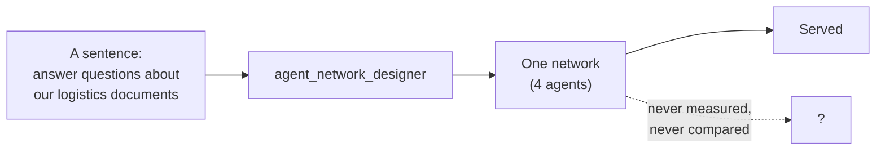
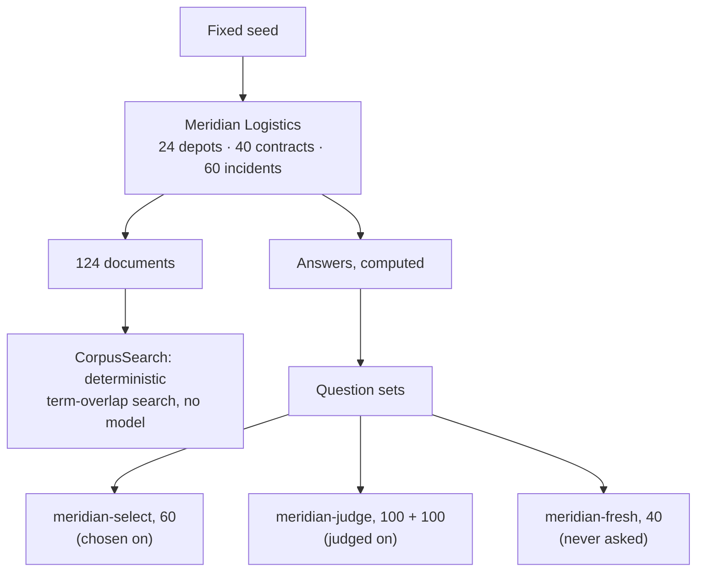
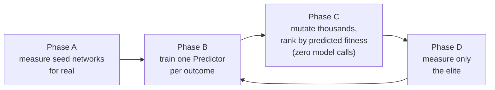
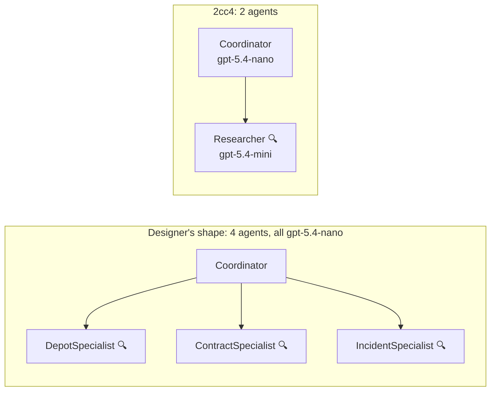
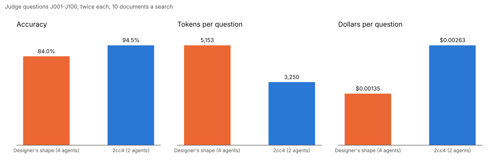
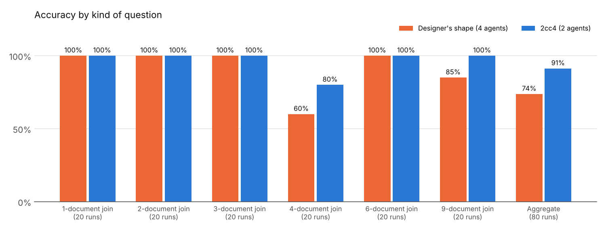
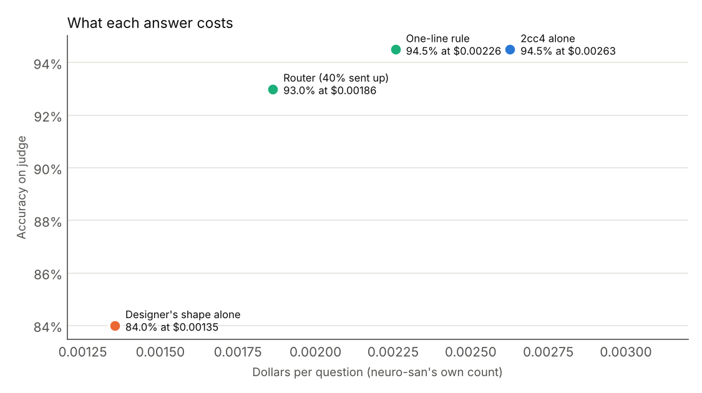
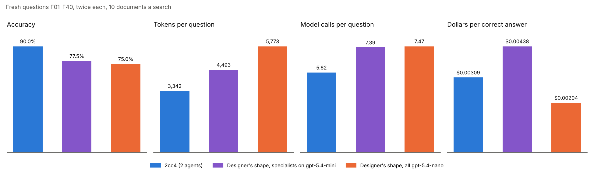
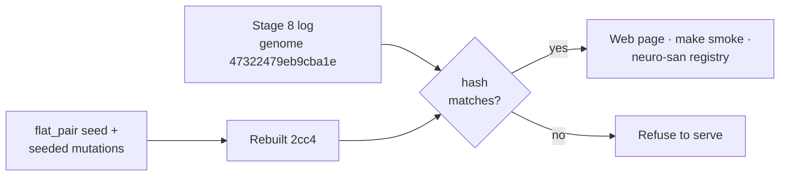

# How neuro-san-esp works, end to end

This report follows one question from the generated world to a measured, searched and served
network, and shows what the measurements say. Every figure here comes from committed logs: the
charts are drawn by `scripts/report_figures.py` and the numbers are checked by the test suite.
[RESULTS.md](RESULTS.md) has every paid stage and [DESIGN.md](DESIGN.md) every part in detail.

## 1. The gap in neuro-san

neuro-san describes a multi-agent network declaratively, as an `agent_network_definition` in
HOCON, and its `agent_network_designer` writes one from a sentence. What neither neuro-san nor
neuro-san-studio has is a way to say whether one network is better than another for the same
job. The designer builds one network, validates that it runs, and stops.



This project supplies the comparison: a fitness function for neuro-san networks, and a
search that uses it.

## 2. The test world

A network can only be scored on questions with known answers, and a public dataset leaks into
model training. So the world is generated from a fixed seed (`esp/eval/world.py`): Meridian
Logistics, with 24 depots, 40 contracts and 60 incidents, written out as 124 documents. No
model has seen it, and every answer is computed from the same data the documents are written
from, so the answer key cannot be wrong the way a hand-written one can.



The depots are split in two by a fixed seed. Select questions name only one half and judge
questions only the other, so a network chosen on select is judged on questions about entities
it never saw while being chosen. Forty percent of the select and judge questions are
aggregates, such as "how many incidents affected contracts serviced by depot D05?", which no
single document answers: an agent has to keep searching until it has every matching document,
then count or sum. The rest are joins that follow identifiers across one to nine documents.
`tests/test_suites.py` re-derives every answer from the document text with a solver that shares
no code with the generator.

## 3. Measuring one network

A candidate network is a neuro-san `agent_network_definition` plus a model per agent
(`esp/genome/definition.py`). Measuring it puts every question to it through neuro-san's own
direct session, the code path a served network uses, with no HTTP round trip
(`esp/eval/runner.py`).

```mermaid
sequenceDiagram
    participant R as Runner
    participant N as neuro-san session
    participant C as Coordinator (front man)
    participant W as Researcher / specialists
    participant T as CorpusSearch
    R->>N: question
    N->>C: user message
    C->>W: sub-question
    W->>T: search terms
    T-->>W: top 10 documents
    W-->>C: facts found
    C-->>N: answer
    N-->>R: answer + token accounting
    R->>R: grade against the key; add tokens, dollars, model calls
```

Three things are recorded per question: whether the answer was right, what neuro-san's own
accounting says the run used in tokens and dollars, and how many model calls it made. A run
that timed out or hit the recursion cap is marked unfinished rather than wrong, and a run that
cost zero tokens, or failed on a provider quota, is refused rather than recorded, because it
measured the environment and not the network.

Those outcomes become one fitness, by a fixed formula that is never learned:

```text
fitness = accuracy − 0.06 · min(tokens / 300000, 1) − 0.02 · (agents / 9)
```

## 4. Searching for a better network

The search follows the structure of ESP, Evolutionary Surrogate-assisted Prescription
([Francon et al., 2020](https://arxiv.org/abs/2002.05368)): real evaluations are expensive, so
a Predictor learned from them ranks candidates for free, and only the best are paid for.



- **Seven mutation operators** change a network: `add_agent`, `remove_agent`, `rewire`,
  `split_agent`, `merge_agents`, `toggle_search` and `reassign_model`
  (`esp/genome/mutations.py`). A mutant that neuro-san could not serve, with an unreachable
  agent, a cycle or no front man, is discarded, never repaired.
- **The Predictor** is one gradient-boosted regressor per outcome, accuracy and tokens, over
  thirteen structural features of a network (`esp/surrogate/outcomes.py`). An outcome whose
  Predictor does not beat its own permutation null is left out of the ranking; token cost
  currently does not.
- **Parents are the Pareto front** on accuracy, spend per correct answer (dollars when known)
  and agent count, not the top few by one number.

There is no learned Prescriptor, which ESP proper has: prescription here is the mutation
operators plus Pareto selection. In shape the search is nearer to LEAF, which evolves network
architectures, with agents where LEAF had layers.

## 5. The head-to-head

The paid runs asked what a reviewer would ask first: does a searched network beat the one the
designer builds, on questions it was not chosen on? Every decision was made on the 60 select
questions; the winner and the designer's shape were then asked the first 100 judge questions,
twice each, on OpenAI's `gpt-5.4-nano`, with search returning 10 documents.



`2cc4` is the hand-written `flat_pair` seed (a Coordinator over a Researcher and an Arithmetic
agent) with Arithmetic removed by `remove_agent`, chosen by measurement on select, and with its
Researcher, the one agent that reads documents, moved to the stronger model.



| 100 judge questions × 2 | `2cc4` | Designer's shape |
| --- | --- | --- |
| Accuracy | **94.5%** (189/200) | 84.0% (168/200) |
| Tokens per question | **3,250** (−37%) | 5,153 |
| Dollars per question | $0.00263 (+94%) | **$0.00135** |
| Agents | **2** | 4 |

`2cc4` was right more often on 17 questions and the designer's shape on 2: a sign test gives
p = 0.0007. Cost is neuro-san's own count, every call's tokens at list price.

**Where the gain comes from.** Both networks answer every one-, two-, three- and six-document
join. The difference is in the questions that end in a count or a calculation: on aggregates
the designer's shape is right 74% of the time and `2cc4` 91%, and on the four-document joins,
which compare two computed figures, 60% against 80%. One reading, not yet tested: a single
agent that searches and keeps every fact it finds counts better than three specialists who
each see part of the evidence and report to a coordinator that has to assemble it. The
stronger model is the other candidate explanation, and the control in section 7 tests it.



**What it costs.** `2cc4` uses 37% fewer tokens, but the Researcher's model is 3.7× dearer per
token, so each question costs 94% more. That is not a pure structure result: the designer's
shape was not measured here with its own specialists promoted. `make replicate` measured
exactly that control (section 7).

## 6. Paying for the strong network only when it helps

ESP prescribes an action for a context. Here the context is the question, the actions are the
two networks, and the outcomes are a right answer and its dollars. `esp/route.py` learns from
the select runs which questions gain from the strong network, fixes a threshold on select, and
is judged once on judge, entirely from the committed logs.



The router sends 40% of questions to `2cc4` and scores 93.0% at $0.00186 a question, 29% less
than `2cc4` alone. Random routing of the same share scores 88.2% (p = 0.0005), so the choice of
questions is real. It does not beat a one-line rule, "two or more named entities, or an
aggregate", which keeps all 94.5% at $0.00226.

## 7. Replication on questions no network has seen

The judge questions J001 to J100 had also been asked in earlier paid runs. `make replicate`
asked forty new questions, F01 to F40 (`esp/eval/fresh.py`), drawn from the judge half with the
same mix and never asked of any network, twice each at 10 documents, of three networks:

- the designer's shape, all on `gpt-5.4-nano`;
- `2cc4` with its Researcher on `gpt-5.4-mini`;
- **the designer's shape with every specialist on `gpt-5.4-mini`**, the control that separates
  the structure from the stronger model.

Every run now also records neuro-san's count of model calls, so this is the first result that
compares API calls as well as tokens.



| 40 fresh questions × 2 | `2cc4` | Control | Designer's shape |
| --- | --- | --- | --- |
| Accuracy | **90.0%** (72/80) | 77.5% (62/80) | 75.0% (60/80) |
| Tokens per question | **3,342** | 4,493 | 5,773 |
| Model calls per question | **5.62** | 7.39 | 7.47 |
| Dollars per correct answer | $0.00309 | $0.00438 | **$0.00204** |

- **The result replicates.** `2cc4` beat the designer's shape on 9 questions against 1,
  p = 0.0215, with 42% fewer tokens and 25% fewer model calls.
- **Structure, more than model.** The stronger model on all three specialists bought the
  designer's shape 2.5 points at more than twice the cost. `2cc4` beat that control on 7
  questions against 1 (p = 0.0703, short of 0.05 on 40 questions) for 29% less per correct
  answer. That is consistent with the reading in section 5: one agent that keeps every fact it finds
  counts better than specialists who each see part of the evidence.
- **Cost, honestly.** Against the all-nano designer, `2cc4` still costs 81% more a question and
  51% more a correct answer.

The run spent $0.65 of a $1.05 cap. [RESULTS.md](RESULTS.md#replication-on-40-fresh-questions)
has accuracy by kind of question, and `tests/test_replication.py` recomputes every figure here
from `results/replication/fresh-2026-10/`.

## 8. Serving the winner

What a person talks to is the network that won on held-out questions. The web page
(`apps/web/serve.py`) and `make smoke` rebuild `2cc4` from the `flat_pair` seed and the paid
search's seeded mutations, check its hash against the one in the stage 8 log, and serve it at
the 10 documents it was judged with. Only one line changes: the front man explains its answer
instead of returning the bare value the scorer needs. On a provider other than OpenAI the
models move rung for rung, and the page says that score was not measured there.



## 9. What this does not show

- **One task domain.** Every question comes from one generated world.
- **Forty fresh questions.** The replication beats the designer's shape significantly, but
  the edge over the model control needs more questions to reach p < 0.05.
- **One generation of search** produced `2cc4`, and the paid search did not use the Predictor:
  every child was measured. Offline, the Predictor picks the best of three unseen networks 62%
  of the time against 33% by chance, level with picking the network with the most agents.
- **Shape is not the whole network.** Two children with the same shape scored 54 and 48 of 60
  on select because their instructions differ, and the Predictor sees only shape.
- **Not novel as an idea.** AgentSquare (ICLR 2025) also searches agent designs with a
  performance predictor. What is new is doing it for neuro-san, which has no fitness function.

## 10. Reproducing

```bash
pip install -e ".[dev]"
make validate                      # lint, docs, HOCON, the suite, an offline search; no key
python scripts/report_figures.py   # every chart in this report, from the committed logs
make route                         # the router, from the committed logs; no key
make replicate                     # the replication plan and its price; GO=1 spends
```

## Sources

| What | Where |
| --- | --- |
| Test world and answer key | `esp/eval/world.py`, `esp/eval/tasks.py`, `esp/eval/suites.py`, `esp/eval/fresh.py` |
| Measuring a network | `esp/eval/runner.py`, `esp/measure.py`, `esp/eval/accounting.py` |
| Genome and operators | `esp/genome/definition.py`, `esp/genome/mutations.py`, `esp/genome/seeds.py` |
| Predictor and search | `esp/surrogate/outcomes.py`, `esp/evolve/loop.py` |
| Paid networks and the winner | `esp/evolve/paid.py`, `scripts/select_and_judge.py` |
| Router | `esp/route.py` |
| Paid-run logs | `results/headtohead/paid-2026-10/`, `results/replication/fresh-2026-10/` |
| Tests that recompute the figures | `tests/test_select_and_judge.py`, `tests/test_route.py`, `tests/test_paid.py`, `tests/test_replication.py` |
| neuro-san | [cognizant-ai-lab/neuro-san](https://github.com/cognizant-ai-lab/neuro-san) |
| neuro-san-studio | [cognizant-ai-lab/neuro-san-studio](https://github.com/cognizant-ai-lab/neuro-san-studio) |
| ESP | Francon et al., *Effective Reinforcement Learning through Evolutionary Surrogate-Assisted Prescription*, GECCO 2020, [arXiv:2002.05368](https://arxiv.org/abs/2002.05368) |
| LEAF | Liang et al., *Evolutionary Neural AutoML for Deep Learning*, GECCO 2019 |
| AgentSquare | Shang et al., *AgentSquare: Automatic LLM Agent Search in Modular Design Space*, ICLR 2025 |
