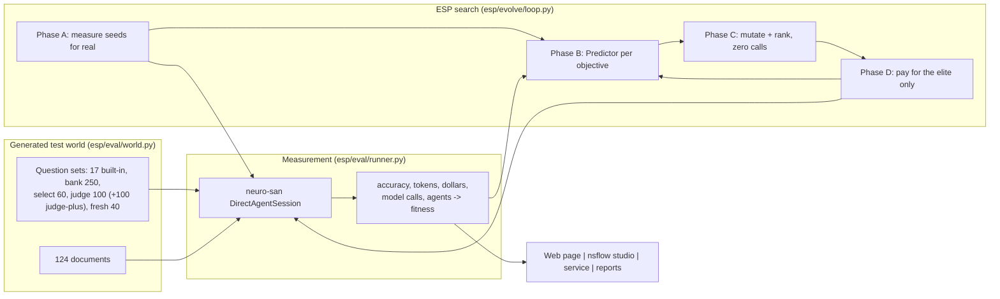

# neuro-san-esp: the complete guide (A to Z)

A hand-off document for another AI (or a person) who has never seen this repository. It says what the
project is, how every part works, what was built and run, every result with its caveats, how to run it,
what is broken or unproven, and the rules to follow when continuing the work.

- **Repository:** `github.com/Sivakumarraj/neuro-san-esp` (Apache-2.0, Python 3.12+)
- **State described:** HEAD `3cd2f34`, "Record the Prescriptor test: no better than one network for every
  question", 2026-11-10. 50 commits in the visible history, 338 tracked files.
- **Written:** 2026-11-18, from the repository's own README, `docs/`, source, tests and committed logs.
- **Every number below comes from a file in the repo**, and the section where it comes from is named. Where a
  statement could not be confirmed from the repo itself it is marked **[unverified]**.

---

## 0. How to use this document

| If you need to... | Read |
| --- | --- |
| Understand the project in one minute | §1 and §2 |
| Know what may and may not be claimed about it | §3 and §14 |
| Understand the architecture and the code | §5 to §9, §17 |
| See what experiments were run and their verdicts | §10 to §12 |
| Run, serve or deploy it | §15 and §16 |
| Continue the work without breaking it | §19 to §21 |
| Look up a term or a file | §22 and §23 |

---

## 1. What this project is

neuro-san (Cognizant AI Lab's open-source library) describes a multi-agent network as data: an
`agent_network_definition` written in HOCON. Its `agent_network_designer` turns one sentence into **one**
working network and stops. Nothing in neuro-san or neuro-san-studio **measures** a network or compares one
network with another. So nobody could say whether a four-agent topology beats a two-agent one for the same
job, or which model each agent should run.

neuro-san-esp adds that missing half, in three parts:

1. **Measure.** Put any neuro-san network through questions with checkable answers and record accuracy,
   tokens, dollars, model calls and agent count.
2. **Search.** Look for a better network using the surrogate-assisted structure of **ESP** (Evolutionary
   Surrogate-assisted Prescription): measure a few networks for real, train a Predictor on them, rank
   thousands of mutants for free, and pay only for the most promising.
3. **Serve.** Put the winner in front of a person: a browser page, neuro-san's accelerator UI (nsflow), or a
   plain neuro-san registry.

### What it is not (say this first, always)

- **It is not ESP in the paper's full sense.** The ESP paper has two learned models (a Predictor and a
  neural-network Prescriptor). Here the *search* has only the Predictor. Its "prescription" is seven mutation
  operators plus Pareto-front selection. In shape it is nearer to **LEAF** (Evolutionary Neural AutoML for
  Deep Learning, GECCO 2019), with agents where LEAF had layers.
- A learned Prescriptor *was* built, for one narrower decision (which of four measured networks answers each
  question). **It did not pass its test** (§12.9).
- **The idea is not novel.** AgentSquare (ICLR 2025) already searches agent designs with a performance
  predictor. What is new is doing it for neuro-san, which had no fitness function.
- neuro-san itself ships ESP at the *other* level (`esp_decision_assistant` uses ESP to help a person decide).
  Same vocabulary, opposite direction: there ESP is what the network *does*; here ESP is what *designs* the
  network.

---

## 2. The result in one screen

Best claim the repository can support (README "Headline", `docs/RESULTS.md`, recomputed by `make all-four`):

On the **100 judge questions, asked twice** (never used to choose the network), at the same hour:

| | `c3`: `2cc4`, Researcher on `gpt-4o-mini`, Calculator on Coordinator | Designer's shape, all `gpt-5.4-nano` |
| --- | --- | --- |
| Accuracy | **93.5%** (187/200) | 80.3% (151/188) |
| Tokens / question | **3,344** (-37.1%) | 5,458 |
| Cost / question | **$0.00072** (-47.1%) | $0.00140 |
| Cost / correct answer | **$0.00077** | $0.00175 |
| Agents | **2** | 4 |
| Fitness (tokens / dollars) | **+0.9192 / +0.9292** | +0.7757 / +0.7917 |

Accuracy: right more often on 23 questions vs 3, sign test p = 0.0001, +14.5 points (95% CI +8.0 to +21.0).
All five pre-registered pass marks held on judge.

**Must be quoted with its caveats** (§14): two changes were made at once and not separated; 12 of the
baseline's 200 judge runs are missing (worst case still passes); on the 40 *fresh* questions accuracy is
**not significant** (88.8% vs 75.0%, p = 0.2668); and the **same-model test fails** (the shape alone is a
~15% saving, not an accuracy gain).

---

## 3. Provenance and honesty statement

- The code was written mostly by **Claude Code** across many sessions. The owner (Siva Kumar Raju) ran it,
  paid for the runs, and found the defects. Do not describe the project as hand-written by one person.
- The project's own culture is **self-correction in public**: README, `docs/FINDINGS.md` and the tests
  record claims that were later walked back (§13). Continue that. Never leave a stronger claim standing than
  the evidence supports.
- Git history visible today starts on 2026-10-10 (`5ffe65e`); per the owner's project notes the history was
  rewritten at least once, and the project was first built in August 2026 (world seed `20260821`; the
  `SERVING.md` transcript is dated 2026-08-22). **[unverified: the rewrite is from notes, not from git]**
- A co-author of the ESP paper reviewed an early version; his feedback is quoted in the docstring of
  `esp/surrogate/outcomes.py` and led to the Predictor/fitness/prescription split (§6.4).

### What was and was not verified while writing this guide

| Check | Result |
| --- | --- |
| Read README, DESIGN, GUIDE, REPORT, RESULTS, FINDINGS, ALL-FOUR, SAME-MODEL, MODEL-ROUTER, PRESCRIPTOR, SERVING, SECURITY, CONTRIBUTING | Done in full |
| Read the core source (genome, mutations, seeds, loop, calculator, corpus tool, paid, serving, route, prescriptor, state, optimizer heads) | Done; other modules read through their docstrings and public API |
| Re-ran the `$0` report scripts on the committed logs: `all_four_report`, `same_model_report`, `model_router_report`, `prescriptor_report`, `route_report`, `uncertainty_report`, `autopsy_report` | Ran; the printed figures I compared match the README and `docs/RESULTS.md` |
| Counted tests | 76 `test_*.py` files, 884 `def test_` functions (grep) |
| Ran the full `pytest` suite, `ruff`, `make validate`, the HOCON validator | **Not run** (neuro-san 0.7.5 is not installed in this container) |
| Checked CI status on GitHub today | **Not checked.** Owner's notes say CI run 201 was green on 2026-11-15 **[unverified now]** |
| Any paid model call | **None.** Nothing here spent money |

---

## 4. Background you need first

| Term | Meaning |
| --- | --- |
| **neuro-san** | Open-source multi-agent framework (cognizant-ai-lab/neuro-san). Pinned here at `neuro-san==0.7.5`. |
| **Agent network** | A set of agents, each with `instructions`, a `description` and `tools` (the down-chain agents it may call). Declared in HOCON. |
| **Front man** | The first entry in a network's `tools`; the agent a request enters through. Order is not cosmetic (§13). |
| **CodedTool** | A Python class (`neuro_san.interfaces.coded_tool.CodedTool`) an agent can call. Here: `CorpusSearch`, `Calculator`, `RunWake`, `ReportFinding`, the evaluator's tools. |
| **`sly_data`** | A private data channel passed to CodedTools, not shown to the model. Never log it. |
| **Registry / manifest** | `manifest.hocon` says which networks are `serve`d and `public`. |
| **`agent_network_designer`** | neuro-san's network generator. It builds one network, validates it runs, stops. |
| **neuro-san-studio** | The example/accelerator repo. Provider order OpenAI, Anthropic, Gemini is copied from it. |
| **nsflow** | neuro-san's accelerator UI (`make studio`, port 4173). |
| **ESP** | Evolutionary Surrogate-assisted Prescription (Francon et al., GECCO 2020, arXiv:2002.05368): context, actions, outcomes; Predictor learns outcomes; Prescriptor maps context to action and is evolved against the Predictor. |
| **LEAF** | Liang et al., GECCO 2019: evolves network architectures. The closer relative of this search. |
| **HASSUM** | Knowlton, Guha, Miikkulainen 2026 (arXiv:2608.14707): escalate when samples disagree in meaning. §12.7 tests its idea. |

---

## 5. Architecture at a glance



**The loop in words.** Phase A measures the seed networks on real model calls. Phase B trains one
`GradientBoostingRegressor` per outcome (accuracy, tokens) on structural features. Phase C breeds hundreds of
mutants and ranks them with the Predictor, which costs no model calls. Phase D really measures only the top
few, and feeds them back into B.

**Four things get used loosely; keep them apart** (`esp/evolve/loop.py` docstring, `docs/DESIGN.md`):

| | What | Learned? | Where |
| --- | --- | --- | --- |
| **Predictor** | One regressor per outcome (accuracy, tokens). Never sees fitness or the weights. | Yes | `esp/surrogate/outcomes.py` |
| **Fitness** | A fixed weighting over outcomes, measured (Phases A, D) or predicted (Phase C). Same function both times. | No | `esp/evolve/loop.py::scalarise` |
| **Prescription** | What proposes the next candidate: seven operators + Pareto selection. | No | `esp/genome/mutations.py` |
| **Agent count** | Exact property of a genome. Counted, never predicted. | n/a | |

---

## 6. The parts, one by one

### 6.1 The genome (`esp/genome/definition.py`)

A candidate **is** a neuro-san `agent_network_definition` plus a per-agent `model` override. It renders
straight to HOCON and runs as an ordinary network.

- `Agent`: `name`, `instructions`, `description`, `tools` (down-chain agent names), `model` (None = inherit),
  `can_search` (gets `CorpusSearch`), `can_calculate` (gets `Calculator`).
- `Genome`: `top` (front man), `agents`, `default_model`. `genome_hash()` is a 16-hex SHA-256 prefix over the
  canonical JSON. **The default model is part of the hash on purpose**: a fitness measured on one model must
  not be mistaken for the same network on another, so the cache misses.
- `with_calculator(name)` returns a copy where one agent has the calculator and the instruction to use it.
- `from_canonical()` rebuilds a genome from its hash blob (tested round-trip), so an evolved winner can be
  served again.
- Budget per candidate: `MAX_STEPS=40`, `MAX_EXECUTION_SECONDS=600`. The time budget must cover queueing in
  the rate limiter, not just thinking.

### 6.2 Seeds (`esp/genome/seeds.py`)

| Seed | Shape |
| --- | --- |
| `solo` | One agent (`Answerer`) with one tool. The floor. |
| `designer_shaped` | `Coordinator` over `DepotSpecialist`, `ContractSpecialist`, `IncidentSpecialist` (4 agents). A **hand-written reconstruction** of what neuro-san's designer produces ("prefer the fewest agents"). It is not the designer's literal output and does not carry studio's AAOSA instructions. |
| `flat_pair` | `Coordinator` over `Researcher` and `Arithmetic` (3 agents). A shape the designer never produces. |

Rules baked into every seed: no instruction may name another agent (a removed agent would become a lie the
network acts on); every agent carries the `_MUST_DELEGATE` clause ("you have no knowledge of Meridian
Logistics... every fact must come from your tools") so the comparison is about topology, not about whether a
model felt like using a tool; `ANSWER_STYLE` demands the bare value so the scorer can match it.

### 6.3 The seven mutation operators and the validity gate (`esp/genome/mutations.py`)

| Operator | Effect |
| --- | --- |
| `add_agent` | Attach a new searching `SpecialistN` under a random agent. |
| `remove_agent` | Drop an agent and re-parent its children. |
| `rewire` | Move one edge. |
| `split_agent` | Turn a non-top agent into a pair (a **twin with identical instructions**), dividing its children. |
| `merge_agents` | Fold one agent into another (keeper's instructions win; abilities and children combine). |
| `toggle_search` | Give an agent the corpus tool or take it away. |
| `reassign_model` | Change one agent's model on the ladder (default written as `None`, never by name). |

**Validity gate (`check`)**: top exists; agent count 1..9; no unreachable agents; no dangling or self
references; acyclic; at least one searcher; no instruction naming a deleted agent. **Invalid mutants are
discarded, never repaired.** The gate checks structure, **not meaning**: it accepted `merge_agents` output
whose only searching agent was told "use only the numbers you were handed" (scored 35/60 on select). Left
unfixed because a stricter gate would stop `select_and_judge.py` reproducing the committed stages.

`esp/genome/prune.py` removes exact-copy agents (the `split_agent` twins): five of the twelve Gemini networks
carried a dead-weight copy.

### 6.4 Fitness and the Predictor

**Token fitness** (`esp/evolve/loop.py`):

```text
fitness = accuracy - 0.06 * min(tokens / 300000, 1) - 0.02 * (agents / 9)
```

`TOKEN_SCALE = 300_000` was set from measurement. An earlier 60,000 clipped every candidate to the same
penalty, giving the cost objective no gradient.

**Dollar fitness** (`esp/eval/pricing.py`): the same shape with
`0.06 * min(dollars_per_question / 0.0325, 1)`. Needed because tokens are fair only when every agent runs the
same model; the search's best move (a stronger router) breaks that. Committed results were selected under the
token fitness and it was left unchanged so history is not silently re-ranked.

**Predictor** (`esp/surrogate/outcomes.py`, `predictor.py`):

- One `GradientBoostingRegressor` per predicted outcome (200 trees, depth 3, lr 0.05, subsample 0.9).
- **13 structural features, nothing measured**: `agents, depth, edges, mean_branching, max_branching,
  leaves, top_degree, searchers, searcher_fraction, mean_model_tier, max_model_tier, mean_instruction_chars,
  total_instruction_chars`.
- Refuses to fit below **8** samples (`MIN_SAMPLES`); then `predict` returns the training mean and `ranks()` is
  `False`, and callers say the generation was random search.
- Quality is **cross-validated Spearman**, always reported against a **permutation null** (shuffle targets,
  rerun the identical CV). An objective that does not beat its own null is held at the population mean (the
  **gate**). On the 12 committed networks: accuracy Spearman +0.63 with margin over null +0.73 (positive in
  20/20 seeds); token cost -0.53 with margin -0.35 (negative 20/20, **excluded 20/20**).
- Model tier is a property of the model (rung, then release), after a fixed defect (§13).
- **Honest status:** the paid results never used the Predictor (every child was measured). Offline, trained on
  nine, it picks the best of three unseen networks 62% of the time vs 33% chance, **level with the rule "pick
  the network with the most agents"** (62.6%). The gate makes the pick *worse* for reasons not understood
  (Predictor with gate off: 71.8%). The gate stays on and this is recorded against it.

**Per-question Predictor** (`esp/surrogate/per_question.py`): predicts the chance of a right answer from the
network's structure plus the question's kind (every question-run is a training row), bootstrap ensemble for a
spread. Tested on planted worlds only; **not yet validated on real measurements**.

### 6.5 Selection: the Pareto front breeds

Parents come from non-dominated sorting on (accuracy up, spend per correct answer down, agents down), ranked
by fitness before any cut, topped up with best scalarised fitness if the front is small. Spend is in dollars
when every candidate has a price, tokens otherwise (`spend_axis`). Two bugs here were found and fixed:
selection ignored the front entirely; then a too-large front was cut in measurement order so seeds stayed
parents (§13).

### 6.6 The context seam (`esp/evolve/context.py`)

ESP prescribes actions for a *context*; the original search has none (every candidate faces the same fixed
set). `Context` states a workload and a price cap; `prescribe` ranks networks for it using the per-question
Predictor. It is an argmax over networks someone else bred and learns nothing, so it is **not** a Prescriptor.

### 6.7 Routers and the learned Prescriptor

- `esp/route.py`: ESP with a context. Context = five regex features of the question's text (`named`,
  `aggregate`, `arithmetic`, `chain`, `numeric`; never the hop count, never the answer). Actions = cheap or
  strong network. Predictor = per-network logistic regression. Prescription = threshold on predicted gain,
  fixed on select by leave-one-out, applied once to judge. (§12.5)
- `esp/model_router.py`: the same idea but choosing only the Researcher's model per question. (§12.5)
- `esp/prescriptor.py` + `esp/nsga2.py` + `esp/prescription.py`: a neural Prescriptor (5 inputs, 8 tanh hidden
  units, 4 outputs, 84 weights) evolved with **NSGA-II** (population 100, 100 generations, seed 20261110)
  against the Predictor on predicted accuracy up and predicted dollars down, scored by leave-one-out chances.
  The first generation contains the four constant prescriptors so it must beat prescribing nothing. (§12.9)

### 6.8 Pool benchmark (`esp/evolve/pool.py`) and rehearsal (`esp/eval/rehearsal.py`)

Measure a pool of ~120 networks once on select, then run hundreds of **free** replicate searches over the
table comparing strategies, each tested against a **permutation null** (Holm-adjusted p-values), effect size =
share of random choice's regret removed. A search sees half the select questions and its pick is scored on
the other half (scoring a pick on the answers it was chosen by rewards luck). Planned full run: 9,000
question-runs, about $61 to $125 on Haiku, $123 to $251 on Sonnet, $20 to $40 on Gemini Flash-Lite. **Never
run on a real provider.** The rehearsal is a simulated provider (planted answer chance) that exercises every
stage for $0; nothing it writes is a result.

### 6.9 The same-budget experiment (`esp/evolve/experiment.py`, `make experiment`)

A Predictor-guided search against a random-choice one at equal budget, selecting on select and judging on
judge. Built, tested against a fake provider, **never run for real** (needs a paid key). A GitHub Actions
workflow (`experiment.yml`) can run it in resumable 5h20m legs; spends only if started by hand and an
`OPENAI_API_KEY` secret exists.

---

## 7. The test world and the question sets

### 7.1 Meridian Logistics (`esp/eval/world.py`)

Generated from fixed seed `20260821`: **24 depots, 40 contracts, 60 incidents, written as 124 documents.**
Fictional on purpose so no model can answer from memory; answers are **correct by construction** (computed
from the same data the documents are written from). Documents carry identifiers `D03`, `C-2105`, `INC-4407`.
Depot: code, city, manager, bays, opened. Contract: ref, client, depot, goods, penalty/hour, annual value.
Incident: ref, contract, hours late, year, cause.

### 7.2 Tools

- **`CorpusSearch`** (`esp/eval/corpus_tool.py`): deterministic term-overlap search, no model, no embeddings,
  identifiers weighted 4x. Returns the top `ESP_SEARCH_RESULTS` documents (**default 3**; the headline runs
  use **10**). At 3, "every incident that..." questions cannot be answered (the word appears in 8 documents).
  **Results at 3 and at 10 are never compared.** `JudgedWidthSearch` hard-codes width 10 (so a model cannot
  widen it itself).
- **`Calculator`** (`esp/eval/calculator_tool.py`): exact arithmetic as a CodedTool. The expression is
  **parsed with `ast`, never evaluated**: only numbers, `+ - * /`, unary signs and parentheses are walked;
  names, calls, attributes, subscripts, powers refused; <= 400 chars; magnitude bounded at 1e15.

### 7.3 Question sets

| Set | Size | Role | Notes |
| --- | --- | --- | --- |
| Built-in (`tasks.py`) | 17 (T01..T17) | First Gemini search | One to four hops; too small to rank networks |
| Bank (`bank.py`, `tasks/meridian_bank.jsonl`) | 250 | First held-out check | Too easy: designer scored 96% |
| `meridian-select` (`suites.py`) | 60 (S..) | **What decisions are made on** | 40% aggregates; harder by construction |
| `meridian-judge` | 100 (J001..J100) | **Judged on, never chosen on** | Other half of the depots |
| judge-plus / `judge-200` (`judge_plus.py`) | +100 (P001..P100) | Temporal, filtered, compare, unanswerable | Constant-reply chance: "not stated" scores 25/100 |
| `meridian-fresh` (`fresh.py`) | 40 (F01..F40) | **Replication**: never asked of any network before | The judge half's last 16 unused aggregates + same mix |

Mix for select/judge/fresh: **40% aggregates** (e.g. "how many incidents affected contracts serviced by depot
D05?", no single document states it) and 10% each of joins over 1, 2, 3, 4, 6 and 9 documents. Depots are
split in two by a fixed seed (`SUITE_SEED=20260926`): select questions name only one half, judge/fresh only
the other. `tests/test_suites.py` re-derives every answer from document text with a solver that shares no code
with the generator.

**Honest caveat:** J001..J100 were asked in earlier paid runs (stages 1, 3, 5) though never used to choose.
Fresh F01..F40 is the truly unseen set, but the calculator idea came from wrong answers on judge and fresh, so
say "never selected on", not "unseen".

### 7.4 Grading (`esp/eval/tasks.py::grade`)

Normalise case/padding/punctuation/thousands separators. A numeric answer is right only if it is **the one
number the reply states** (numbers given in the question are ignored, question sentences are stripped first,
an abstention that states a number has not abstained). Earlier containment grading gave marks to replies that
listed the numbers 0..20 (90 of 200 judge answers). Aggregate questions can have many correct answers
(`accepted`). All 272 committed replies are re-graded by `tests/test_grade.py`.

---

## 8. Measurement machinery

### 8.1 The runner (`esp/eval/runner.py`)

- One `DirectAgentSessionFactory` per process (built under a lock; manifest read takes ~8 s). No HTTP round
  trip; the same code path a served network uses.
- Thread pool of `ESP_WORKERS=4` tasks in parallel; results cached per genome hash in `.esp-cache/`
  (`ESP_CACHE`), keyed also on search width and step settings (a run with non-default `ESP_SEARCH_RESULTS` or
  `ESP_MAX_STEPS` gets its own directory).
- **`TaskResult.infrastructure`** marks a run that never answered (timeout, recursion cap, exception).
  Unfinished is **not** wrong: `accuracy` counts it wrong, `answered_accuracy()` excludes it, both are shown.
- **Never cache a poisoned measurement.** A quota failure, a missing key, a zero-token run (`acc=0.00 tok=0`)
  is refused, not recorded. This is "the single most important correctness property in the repository"
  (`SECURITY.md`): a cached zero teaches the search that a good topology is bad.
- Cache entries keep the first 400 characters of each answer; treat as untrusted text.

### 8.2 Accounting (`esp/eval/accounting.py`)

neuro-san reports usage as a network total *and* per-model; the runner once added both, so **every token and
dollar figure written before 2026-10-10 is exactly 2x the real one**. Records are never rewritten:
`accounting: 2` marks new ones, older ones are halved on read, in this one module. Accuracy, ratios, p-values
and fitness are unchanged. **Cost = neuro-san's own count at list prices, no cache discount.** The dollar cap
during paid runs used a more cautious figure (larger of that and a blended estimate), so cap-basis percentages
differ (e.g. +94% vs +71%).

### 8.3 Rate limiting and failover (`esp/eval/ratelimit.py`, `failover.py`)

- Per-model sliding-window limiter patched underneath LangChain clients (Google, plus Anthropic/OpenAI when
  present). `ESP_RPM` default 14 (one under Gemini's free 15/min; slow on a paid key, ~12 min queueing per
  candidate). Async-safe (an earlier `time.sleep` froze the whole event loop).
- Free-tier caps are **per model per day** (500 on flash-lite models, ~20 on `gemini-3.5-flash`); one candidate
  needs ~165 requests. `failover.py` retires a spent model and rewrites calls to the next rung; caps are data
  (`MEASURED_CAPS`) and the ladder is derived from them. Provider errors are classified by status code with
  one shared retry policy. `ESP_PIN_MODELS=1` makes an exhausted model **stop the run instead of being swapped**
  (a swap once made a comparison measure the designer against a copy of itself).
- Spent-key / empty-balance responses stop the run at once.

### 8.4 Providers and ladders (`esp/config.py`)

Chosen like neuro-san-studio: by key present, order OpenAI, Anthropic, Gemini; `ESP_PROVIDER` forces one.

| Provider | Key | Workers | Promoted router |
| --- | --- | --- | --- |
| Anthropic | `ANTHROPIC_API_KEY` | `claude-haiku` | `claude-sonnet` |
| OpenAI | `OPENAI_API_KEY` | `gpt-5.4-mini` | `gpt-5.5` |
| Gemini | `GOOGLE_API_KEY` | `gemini-3.5-flash-lite` (committed runs: `gemini-3.1-flash-lite`) | `gemini-3.5-flash` |
| OpenRouter | `OPENROUTER_API_KEY` | `openrouter/free` | same |

The **paid head-to-heads were run with `ESP_PROVIDER=openai ESP_DEFAULT_MODEL=gpt-5.4-nano
ESP_MODEL_TIERS=gpt-5.4-nano,gpt-5.4-mini`** (`MEASURED_MODELS` in the Makefile). With only an OpenAI key and
no override, the default ladder is different and builds networks no committed run measured, so the Makefile
pins them. `bootstrap()` loads `.env` before anything reads env at import time.

### 8.5 Preflight (`esp/service/preflight.py`, `scripts/check_key.py`)

A misconfigured evaluator does not crash; it scores everything zero and the cache keeps it. So preflight
**refuses to start** on: placeholder key, model needing a different provider's key, state measured on another
provider, bad tiers, missing `AGENT_TOOL_PATH`/`PYTHONPATH`, unwritable state dir. It asks the provider
whether the key *works* (listing models is free), not merely whether the variable is set.

### 8.6 Statistics (`esp/eval/stats.py`, `same_model.py`)

Paired sign test (exact two-sided McNemar) over questions; Wilcoxon signed-rank over **25 four-question
chunks** (each chunk's two repeats averaged) for tokens and dollars, because the provider reports usage per
chunk, not per question; bootstrap 95% CI on the accuracy difference.

---

## 9. Networks catalogue (names you will meet)

| Name | What | Hash |
| --- | --- | --- |
| designer's shape (`designer`) | 4 agents, all `gpt-5.4-nano`. The baseline. | `0378ca26cd9fe977` |
| `flat` | the `flat_pair` seed, copies removed | `c3ee2e0c4a6156c5` (Gemini) |
| **`2cc4`** | `flat_pair` with `Arithmetic` removed by `remove_agent` (one mutation, chosen by measurement on select, from search seed `20261002`, 8 children). 2 agents: Coordinator + Researcher. All nano. | `2cc4231b7d3fb81d` |
| **`2cc4-mini`** (a.k.a. "evolved", the "strong network") | `2cc4` with Researcher on `gpt-5.4-mini` | `47322479eb9cba1e` |
| designer-promoted (control) | designer's shape, every specialist on `gpt-5.4-mini` | |
| `c1` | `2cc4` all nano + Calculator on Coordinator | `ae41fbfaa513ed47` |
| `c2` | `2cc4`, Researcher on `gpt-4o-mini` | `e212a77c53bfa809` |
| **`c3`** | `2cc4`, Researcher on `gpt-4o-mini`, Calculator on Coordinator. The **all-four headline network**. | `f4e9e494442f9888` |
| Gemini twelve | 3 seeds + 9 mutants measured on 17 questions; committed in `tests/fixtures/cache/` | e.g. best `3bf9c008d880c3fc` |

`gpt-4o-mini` ($0.15 / $0.60 per M tokens) is **priced below** `gpt-5.4-nano` ($0.20 / $1.25). Never call it
"a stronger model". It was chosen because it is the only cheaper OpenAI model neuro-san 0.7.5 prices correctly.
`gpt-5.4-mini` is $0.75 / $4.50, about 3.7x nano per token.

`esp/evolve/paid.py::winner()` **rebuilds** `2cc4-mini` from the seed plus the seeded mutations and **raises if
the hash is not the logged one**, so what is served is provably what was measured (same for
`judged_designer()`).

---

## 10. Chronology: what was built and what was run

| Date | What | Evidence |
| --- | --- | --- |
| Aug 2026 | Project built. Seeds, genome, operators, runner, Predictor, service. 22 Aug: free-tier failover ladder proved wrong by a real run. | `FINDINGS.md`, `SERVING.md` |
| Aug-Sep | **12 networks, 17 tasks, 204 real runs** on `gemini-3.1-flash-lite` (free tier, ~4 days of budget). Best: reassign-model mutant 94.1% (16/17), fitness 0.8941. One generation deep because of quota. | `results/history.json`, `tests/fixtures/cache/` |
| Sep | Review feedback leads to per-objective Predictor, permutation null, token-cost gate. ~12 defects found by running it (§13). | `esp/surrogate/outcomes.py` |
| 25-29 Sep | Held-out bank (24 questions): evolved 21 vs designer 23, **no support** for the evolved net. 29 Sep live judge reruns: level accuracy, evolved ~2x cost. | `results/heldout_bank/`, `results/live/` |
| Oct 2 | Paid search seed `20261002` from `flat` on OpenAI. | `results/headtohead/paid-2026-10/` |
| Oct 10 | **Token/dollar accounting fix (2x)**; audit; hardening commits. | `35159e4`, `esp/eval/accounting.py` |
| Oct 23-24 | Router; held-out 94.5% vs 84.0%; replication with model control; same-budget workflow. | `2626748`, `2a95f85`, `db3ae7a` |
| Oct 24-25 | Uncertainty study, autopsy, tracer; hardening (`9e69289`). | `26efc55`, `d8972be` |
| Oct 29 | CI hardening (pinned actions, `pip-audit`, HOCON validator, coverage >= 85%); error classification; spend-per-correct breeding. | `7af6b94` |
| **Nov 7** | **Same-model test, Researcher-routing test, Calculator CodedTool, all-four test and new headline**, 4K film. Each test's plan committed before the run. | `docs/SAME-MODEL.md` etc. |
| **Nov 10** | **Prescriptor test**: plan pushed (`ec1d00a`) before outcome computed, result recorded (`3cd2f34`): does not pass. | `docs/PRESCRIPTOR.md` |

### Paid stages (`results/headtohead/paid-2026-10/`, all on OpenAI, models pinned)

| Stage | What | Outcome |
| --- | --- | --- |
| 0 | Four-question check | |
| 1 | Designer vs pruned Gemini champion (router on mini), J001..J100 | 68/100 each (2nd repeat stopped after 12); champion 2.1x cost. **The stronger router bought nothing.** |
| 2, 3 | Six committed networks + designer on select; best on judge x2 | `flat` 51/60 vs designer 47/60; judge 155/200 vs 135/200, p = 0.011, equal tokens (a seed won) |
| 4, 5 | 8 children of `flat` on select (4 stopped short); best on judge x2 | `2cc4` 54/60; judge 153/200 vs 138/200, p = 0.052, 17% fewer tokens |
| 6 | Same pair on P001..P100 once | 77 vs 68, p = 0.108, 7% more tokens |
| 7 | **Search fixed to 10 documents**; four networks on select | `2cc4`+mini Researcher 57, `flat` 53, `2cc4` 52, designer 48 of 60 |
| 8 | That network vs designer, judge x2, 10 documents | **189/200 vs 168/200, p = 0.0007**, -37% tokens, +94% cost/question |

Spend by neuro-san's own count: stages 0-5 **$2.31** (1,888 question-runs); stages 6-8 **$1.42** more. The
fresh replication spent **$0.65** of a $1.05 cap.

---

## 11. Why 3 documents vs 10 matters

With `ESP_SEARCH_RESULTS=3` the designer's shape scored 67-70 of 100 on judge in every run; with 10 it rose to
84% on the same questions. The earlier search tool was *capping* accuracy: for a question whose answer is 5
incidents, the network counted the 3 it was shown. Stages 1-6 are at 3, stages 7-8 and everything after at 10.
**Never compare across the two.**

---

## 12. All results, with verdicts

All recomputed from committed logs by a test and by a `$0` `make` target.

### 12.1 The first search (17 questions, Gemini)

12 networks. Best `mut:reassign_model` (Coordinator moved to `gemini-3.5-flash`, specialists left cheap):
**94.12%**, 179,800 tokens, 5 agents, fitness **0.8941**; the cheaper winner 88.24% at 130,026 tokens. Both
wins came from the same knob: a stronger **router/front-man**. Verdicts after scrutiny:

- **17 questions cannot rank networks.** Held-out half-splits carry rank correlation of only +0.022 (accuracy)
  / +0.108 (fitness); the selection winner was never ranked first on the held-out half. The searched winner
  beat the designer in 90% of 200 splits but a **random** network from the population does so 85.5% of the time
  (`make holdout`). The designer's shape ranked 11th of 12.
- The champion's gain was the stronger router; on held-out questions it **tied** the designer at 2.1x the cost.
- All three seeds scored 0.8235 but for different reasons (recursion caps, timeouts): the tie was **not** a
  finding.
- Token cost differs 95% across the population (121,335 to 236,725) at accuracies within 18 points.

### 12.2 The held-out head-to-head (stage 8) -- "the most accurate network"

100 judge x2, 10 documents. `2cc4`+`gpt-5.4-mini` Researcher vs designer's shape (all nano):

| | `2cc4-mini` | Designer's shape |
| --- | --- | --- |
| Accuracy | **94.5%** (189/200; 91 then 98) | 84.0% (168/200; 82 then 86) |
| Tokens / q | **3,250** (-37%) | 5,153 |
| Cost / q | $0.00263 (+94%) | **$0.00135** |
| Cost / correct | $0.00278 (+72%) | **$0.00161** |
| Agents | 2 | 4 |

Better on 17 questions vs 2, sign p = 0.0007. Where the gain is: aggregates 91% vs 74%; four-document joins
(compare two computed figures) 80% vs 60%; both answer every 1-, 2-, 3- and 6-document join. **Not a pure
structure result** (stronger model on the reader agent).

### 12.3 Replication on 40 fresh questions with a model control (`make replicate`)

| 40 fresh x2, 10 docs | `2cc4-mini` | Control (designer, specialists on mini) | Designer, all nano |
| --- | --- | --- | --- |
| Accuracy | **90.0%** (72/80) | 77.5% (62/80) | 75.0% (60/80) |
| Tokens / q | **3,342** | 4,493 | 5,773 |
| Model calls / q | **5.62** | 7.39 | 7.47 |
| Cost / q | $0.00278 | $0.00340 | **$0.00153** |
| Cost / correct | $0.00309 | $0.00438 | **$0.00204** |

vs designer: better on 9, worse on 1 (F12), p = 0.0215. vs control: 7 vs 1, **p = 0.0703 (not significant at
0.05)**. Promoting every specialist bought the designer only +2.5 points and more than doubled cost, so "a
stronger model alone" does not explain the gain, and the shape alone does not either (§12.4).

### 12.4 Same model, half the agents (test 1; **fails**) -- `docs/SAME-MODEL.md`

Plan pushed before the run. Judge x2, every agent `gpt-5.4-nano`: `2cc4` 82.0% (164/200) vs designer
**84.0%** (168/200); tokens **-14.6%** (17/25 chunks, p = 0.027), dollars -14.6% (18/25, p = 0.0087);
accuracy 8 vs 12, p = 0.5034, -2.0 points (CI -7.5 to +3.5). Accuracy and fitness fail. On fresh the lean is
the other way, not significant (80.0% vs 70.0%, p = 0.2101). **Conclusion: the 2-agent shape is a ~15% saving,
not an accuracy gain; the headline accuracy needs the stronger model on the Researcher.**

### 12.5 Routing

- **Per-question router** (`make route`, fitted on select, judged once on judge): cheap alone 84.0% at
  $0.00135; **router 93.0% at $0.00186** (40% sent up; 29% cheaper than strong alone); strong 94.5% at
  $0.00263. Random 40%: 88.2% (p = 0.0005). **It does not beat a one-line rule** ("two or more named entities
  or an aggregate"): 94.5% at $0.00226 (71% sent up). Oracle 95.5%. Readable coefficients: a chain of
  references helps the cheap network most (+1.81); each named entity hurts it (-0.98).
- **Researcher's model per question** (test 2, `docs/MODEL-ROUTER.md`; **fails**): the budget allows 4 of 60
  select questions on mini, mini beat nano on 6 and the Predictor ranks none first, so the router sends
  **nothing up** and equals `2cc4`-nano. Not a test: knowing every answer within budget, sending up 17 judge
  questions would score 94.5% at $0.001384 (better on 18 worse on 1, p = 0.0001). That is an **oracle bound,
  not a result**; what is missing is a pre-answer signal of which questions need the strong model.
- Researcher-routing "headline held same day": `2cc4`-mini 95.5% (191/200) on 7 Nov vs 94.5% in October.

### 12.6 All four at once (test 3; **passes on judge**) -- `docs/ALL-FOUR.md`

Select screening (60 questions once, 7 Nov, same hour):

| Network | Accuracy | Tokens/q | $/q |
| --- | --- | --- | --- |
| Designer's shape | 75.0% | 5,681 | $0.001474 |
| c1 (nano + Calculator) | 91.7% | 5,776 | $0.001455 (ineligible: more tokens) |
| c2 (`gpt-4o-mini` Researcher) | 90.0% | 2,828 | $0.000627 |
| **c3** (4o-mini Researcher + Calculator) | **93.3%** | 4,055 | $0.000854 |

Eligibility rule (committed before any judge run): more accurate than baseline **and** fewer tokens **and**
fewer dollars; winner = most accurate eligible, ties to cheaper then fewer tokens; none eligible stops the
test. Result: c3. Five pass marks on judge: accuracy (sign p<0.05), tokens (Wilcoxon p<0.05), dollars
(Wilcoxon p<0.05), fewer agents, higher token **and** dollar fitness. **All five hold** (table in §2; tokens
lower in 23/25 chunks, p = 8.3e-07; dollars lower in 25/25, p = 6e-08).

Missing runs: the key ran out of credit with **12 of the designer's 200 judge runs left** (second pass over
J089..J100). Counting all 12 right at zero tokens/cost: designer 81.5%, accuracy p = 0.0005, tokens p =
5.4e-05, dollars p = 2e-06 -- verdict stands (`esp/all_four.py::worst_case`).

Fresh (the replication): c3 **88.8%** (71/80) vs designer 75.0% (60/80); tokens -27.8% (p = 0.014), dollars
-41.3% (10/10 chunks, p = 0.002); accuracy +13.8 points (CI +1.2 to +27.5), 9 vs 4, **p = 0.2668 -- not
significant**. Fresh was run alongside the plan and partly seen, so it cannot rescue the test.

Where c3's gain comes from: a *near miss* (wrong number within 10x of the truth on a question that computes
one) fell from 20 runs on all-nano `2cc4` to 2 on c3; wrong *counts* fell from 11 to 5, which is probably the
`gpt-4o-mini` Researcher, not the calculator. On select the calculator alone took `2cc4` to 91.7% and the
`gpt-4o-mini` Researcher alone to 90.0%; **only the pair was judged**, so the two changes are not separated.

The designer's shape moved between runs: 168/200 in the morning, 151/188 in the afternoon at the same
settings. Only the same-hour pair is compared, as the plan fixed.

### 12.7 Uncertainty: a flag, not a gate (`make uncertainty`)

Idea from HASSUM, applied to two runs per question that already exist (semantic entropy of two samples = one
bit; no embeddings, since "116" and "136" are far apart as answers).

| Designer's shape, all nano | Judge (100) | Fresh (40) |
| --- | --- | --- |
| Right when its two runs agree | 96.3% (82 q) | 96.7% (30 q) |
| Right when they disagree | 27.8% (18 q) | 10.0% (10 q) |
| Gate (both runs, strong on disagree) | 92.5% at $0.00318 | 88.8% at $0.00376 |
| One-line rule | **94.5% at $0.00226** | **90.0% at $0.00241** |

`2cc4`'s two runs agreed on 90 judge questions and it was right on all 90. As a **flag** it works (marks
answers to check). As a **gate** it loses: two cheap runs on every question cost more than one strong run
unless the cheap network costs < 0.41 of the strong one (here 0.515). Every disagreement (18/18 judge, 10/10
fresh) is a question the rule already sends up. Agreeing wrong answers: J004, J035, J087 (judge), F11 (fresh)
-- the search tool is deterministic, so a second run reads the same documents and makes the same mistake.
Untested: resampling a single agent's reply inside the network (a neuro-san uncertainty middleware).

### 12.8 Where the errors are (`make autopsy`, `make trace`)

16 of the 140 judge+fresh questions charge several incidents at their contracts' penalty rates. They hold 30 of
the designer's 52 wrong runs and 14 of `2cc4`'s 19. Of 60 wrong penalty runs, **at most 2 are partial sums**
(retrieval); the rest are arithmetic over numbers the network had. J004 and F11 (confident misses) are the
difference of the two contracts' hourly rates: **found both contracts, never multiplied by hours**. This is
the evidence behind adding the Calculator. `esp/trace.py` keeps every message and takes per-agent usage apart
(an invocation's own usage = its subtree less the subtrees of the nearest reporting children). `make trace`
is plan-only; `GO=1` is about $0.07. **Never run live** (no key in the build container) **[per FINDINGS]**.

### 12.9 The learned Prescriptor (test 4; **fails**) -- `docs/PRESCRIPTOR.md`

Four actions (designer, `2cc4`-nano, `2cc4`-mini, `c3`). Budget = designer's $0.001367/q. Static prescription
= `c3` everywhere. The chosen prescriptor sends 15/60 select questions to `2cc4`-mini and 45 to `c3`, the
same 15 in all 20 seeds.

| | Sent to mini | Prescriptor | `c3` alone | Better/worse, p | Random same shares | Cost vs `c3` |
| --- | --- | --- | --- | --- | --- | --- |
| First turn, judge | 34% | 96.0% | 93.5% | 4, 1, p = 0.375 | 94.2% (p = 0.1235) | +77.6% |
| First turn, fresh | 38% | 91.2% | 88.8% | 2, 0, p = 0.5 | 88.3% (p = 0.1811) | +60.4% |
| Second turn, fresh | 40% | 90.0% | 88.8% | 5, 4, p = 1.0 | 88.2% (p = 0.335) | +79.6% |

Against the designer's shape four marks of five hold; dollars do not (-7.7%, lower in only 13/25 chunks,
p = 0.4108). Why: `c3` is the cheapest of the four and within ~2 points of the best, so there was little to
prescribe over; five text features do not say which questions need the dearer network; adding 100 questions
of outcomes did not change that. Oracle bound (not a result): knowing every answer the four networks answer
every judge question at $0.00087 each. **ESP's two models both exist now, for this one decision; the
networks themselves were still found by mutation, selection and a person adding a calculator.**

### 12.10 Summary scorecard

| Question | Verdict |
| --- | --- |
| Did search beat the designer's shape on held-out questions? | Yes with the stronger Researcher model (p = 0.0007, replicated on fresh p = 0.0215) |
| Is the shape alone better? | No on accuracy (p = 0.5034); yes ~15% cheaper |
| Is the stronger model alone the explanation? | No (control gained only 2.5 points; `2cc4`-mini beat it 7 vs 1, p = 0.0703 n.s.) |
| Better on accuracy, tokens, cost and agents at once? | Yes on judge (c3, p = 0.0001), not significant on fresh accuracy |
| Does the Predictor help the search? | Not shown. Picks better than chance offline, level with "most agents" |
| Does a per-question router beat a one-line rule? | No |
| Does a learned Prescriptor beat one network for all? | No |
| Is two-run agreement a useful gate? | No (flag only) |

---

## 13. Bugs and corrections found by running it

Each was found by *running*, not reasoning, and most made a good network score zero or a bad one look good
(the failure that does not announce itself).

1. **Front man was alphabetical.** `to_hocon()` emitted agents alphabetically but neuro-san takes the first
   `tools` entry as the front man. `flat_pair` ran with `Arithmetic` in front and scored 0.00.
2. **Cost objective had no gradient.** `TOKEN_SCALE` 60,000 clipped every candidate to the same penalty.
3. **Blocking sleep in an async path** froze neuro-san's event loop (caught by ruff `ASYNC251`).
4. **Two kinds of free-tier quota** (per-minute clears by waiting; per-day never does); told apart by
   `quotaId` in the 429 payload.
5. **Service recorded the wrong exhausted model** (matched the failover ladder; the failing model was the
   network default).
6. **Timeouts and recursion caps cached as wrong answers**; unfinished now ≠ wrong.
7. **Duplicate-answer ground truth**: an aggregate had 20 equally correct answers; 19 were scored wrong.
8. **First task set had no headroom** (one agent + one tool scored 1.00); corpus widened 40 to 124 docs,
   retrieval cut from 5 to 3, hard shapes added.
9. **Quota guard refused real answers**: it read "429" anywhere, and INC-4429 is a real document.
10. **Scorer gave marks for listing numbers** (see §7.4).
11. **Pool benchmark scored a pick on the answers it was chosen by**, and its bootstrap measured the luck of
    one pool; replaced with a permutation null and Holm adjustment. An unmeasurable network once stopped the
    pool for good.
12. **Plan priced 9,000 runs at a made-up 12,000 tokens/question**; now priced from the range committed runs
    cost.
13. **Pareto front never consulted by selection**, then cut in measurement order so seeds stayed parents.
14. **Model-tier feature mislabelled** (cheapest model read as highest tier); fixed, no conclusion changed.
15. **Token and dollar figures 2x** (accounting fix, 2026-10-10).
16. **A model swap erased the comparison** (failover moved both networks to the same model); now
    `ESP_PIN_MODELS`.
17. **Container could not run its documented service** (Dockerfile omitted `apps/` and `registries/`);
    `tests/test_container.py` now checks.
18. **Undeclared dependencies** (reportlab, Google driver, langchain-anthropic, nsflow) that only a clean
    install can notice; every direct dependency is now pinned and declared.
19. **Documentation claims that were too strong**, corrected where they stand: the holdout's 90% had no
    baseline (random scores 85.5%); the ablation's 62% matches a no-training rule; a null-on-ties argument was
    wrong; a constant reply is not worthless on judge-plus.
20. **Earlier headline "94.1% / -7%" and "88.2% / -32.5%"** were measured on 17 in-sample questions. **Dead;
    never use.**
21. **Predictor claimed as a contribution** until AgentSquare (ICLR 2025) turned out to have published the
    idea first.

---

## 14. What may and may not be claimed (checklist for any writer)

**May say**

- "On 100 held-out judge questions asked twice, `c3` (2 agents) beat the designer's shape (4 agents) on
  accuracy, tokens, dollars, agents and fitness together (93.5% vs 80.3%, p = 0.0001)." Then add the caveats.
- "The same-model test failed: the shape is ~15% cheaper at no measurable accuracy loss."
- "The learned Prescriptor was built and did not beat one network for every question."
- "The repository's figures are recomputed from committed logs by tests."

**Never say**

- "Structure alone won", or call the winner simply "evolved". Its model and its calculator were chosen **by
  hand**; only `2cc4` itself is one mutation of a hand-written seed.
- "A stronger model" about `gpt-4o-mini` (it is priced *below* nano).
- "Unseen" for judge or fresh questions. Say "never selected on".
- That the Predictor chose `2cc4` (no paid stage used it; every child was measured).
- That fresh accuracy is significant (p = 0.2668).
- That this is "ESP" without the qualifier.
- Anything from the dead list: 94.1%/-7%, 88.2%/-32.5%, "strong model on the router", "the surrogate ranked a
  mutant pool".
- Absolute token/dollar figures from before 2026-10-10 without the accounting correction.

**Always attach:** two changes made at once and not separated; 12 baseline runs missing (worst case still
holds); baseline is a *hand-built copy of the designer's shape*, not what the designer itself generated for
these questions (never measured); one question world; the calculator idea came from errors on judge and
fresh; cost is neuro-san's count at list prices, not a bill.

---

## 15. Repository layout

```text
neuro-san-esp/
  README.md  SERVING.md  SECURITY.md  CONTRIBUTING.md  SUPPORT.md  CODE_OF_CONDUCT.md  CITATION.cff  LICENSE
  Makefile  pyproject.toml  requirements.lock  constraints.txt  Dockerfile  compose.yaml  .env.example
  .devcontainer/      Python 3.12 Codespace; ports 7860 (web), 4173 (studio), 8080, 8081
  .github/            ci.yml, experiment.yml, issue + PR templates
  apps/web/           serve.py (FastAPI, 883 lines) + page.html
  apps/optimizer/     run_optimizer.py (one wake by hand/cron) + README
  deploy/huggingface/ Dockerfile + Space README (port 7860)
  docs/               DESIGN GUIDE REPORT RESULTS FINDINGS SAME-MODEL MODEL-ROUTER ALL-FOUR PRESCRIPTOR
                      + 6 older PDFs, proofs/ (captured transcripts), screenshots/, video/ (3D film source)
  esp/                the library (about 15,000 lines)
  registries/         manifest.hocon, optimizer.hocon, evaluator.hocon
  results/            committed paid-run logs, figures, history.json, summaries
  scripts/            34 entry points behind the make targets
  state/              champion.json (example state)
  tasks/              meridian_bank.jsonl
  tests/              76 test files, 884 test functions; fixtures/cache = the 12 committed measurements
```

### `esp/` module map

| Module | Role |
| --- | --- |
| `config.py` | `.env` bootstrap, provider selection, ladders, `model_rank`, `cost_tier` |
| `genome/definition.py` | `Agent`, `Genome`, hashing, HOCON rendering, model ladder |
| `genome/mutations.py` | seven operators, `check`, `mutate` |
| `genome/seeds.py` | `solo`, `designer_shaped`, `flat_pair` |
| `genome/prune.py` | remove exact-copy agents |
| `eval/world.py` `tasks.py` `suites.py` `bank.py` `judge_plus.py` `fresh.py` | the world, question sets, grader |
| `eval/runner.py` | measure a genome; cache; unfinished handling |
| `eval/accounting.py` `pricing.py` `stats.py` | units, dollars and dollar fitness, tests |
| `eval/ratelimit.py` `failover.py` | pacing and model failover |
| `eval/corpus_tool.py` `calculator_tool.py` | the two CodedTools candidates may use |
| `eval/measurements.py` `holdout.py` | the 12 committed measurements; half-split analysis |
| `eval/rehearsal.py` | simulated provider |
| `evolve/loop.py` | the ESP loop, `scalarise`, `non_dominated`, `History` |
| `evolve/pool.py` `experiment.py` `headtohead.py` `context.py` `paid.py` | pool benchmark, same-budget experiment, head-to-head, context seam, paid networks and `winner()` |
| `surrogate/predictor.py` `outcomes.py` `per_question.py` | Predictors |
| `route.py` `model_router.py` | routers |
| `prescriptor.py` `nsga2.py` `prescription.py` | learned Prescriptor |
| `same_model.py` `all_four.py` | the pre-registered tests' code |
| `uncertainty.py` `autopsy.py` `trace.py` | agreement study, error autopsy, per-agent tracer |
| `measure.py` | measure any network on any question file (CLI + library) |
| `serving.py` | turn a measured network into a servable one (full answers; provider retarget) |
| `service/optimizer.py` `state.py` `preflight.py` `coded_tools.py` `measure_tools.py` | the unattended service |
| `report/` | PDFs and figures (dossier, primer, explainer, guide, plots, build) |

### `make` targets

| Target | Does | Cost |
| --- | --- | --- |
| `install` | `pip install -e ".[dev]"` | $0 |
| `validate` (= `check`) | lint + docs lint + HOCON validator + full suite + offline search | $0 |
| `test`, `lint`, `lint-docs`, `hocon`, `offline-check` | the pieces of `validate` | $0 |
| `offline` | Phases B and C on committed measurements, pool 2000 | $0 |
| `null-sweep`, `ablation`, `figures`, `holdout` | Predictor/null/selection analyses from committed data | $0 (`ablation` ~45 CPU-minutes) |
| `route`, `uncertainty`, `autopsy`, `same-model`, `model-router`, `all-four`, `prescriptor` | recompute each result from logs | $0 |
| `bank`, `bank-report`, `cost-report` | held-out bank file/report, every network in tokens and dollars | $0 |
| `check-key` | does the provider accept the key (one free call) | ~$0 |
| `smoke` | 4 real questions to the served network | a few dozen calls |
| `measure NETWORK=.. TASKS=..` | measure your own network | paid |
| `baseline` | measure the 3 seeds (~500 calls) | paid |
| `search` | full loop (3 generations, elite 3) | paid |
| `replicate [GO=1]` | the 3-network fresh replication (~$0.70) | plan-only without `GO` |
| `same-model-run [GO=1] [SUITE=]` | repeat the same-model run (~$0.60 judge) | plan-only without `GO` |
| `headtohead`, `pool`, `experiment` | plan, `REHEARSE=1` ($0 simulated), or `GO=1` | `GO=1` pays |
| `trace [GO=1\|REPORT=1]` | per-agent trace (~$0.07) | plan-only without `GO` |
| `probe` | Gemini free-tier model caps | free-tier |
| `verify` | start a real neuro-san server and prove it fires the optimiser by cron | needs key |
| `studio` | nsflow UI on 4173 with every measured network | $0 to open |
| `champion` | write a servable `registries/champion.hocon` | $0 |
| `service-report`, `report` | build report from the service state / batch cache | $0 |
| `proofs`, `dossier`, `primer`, `explainer`, `guide` | PDFs and captured transcripts | $0 |
| `docker`, `clean` | image build/run; clean caches | |

### `scripts/` highlights

`select_and_judge.py` (the paid-run driver: `networks`, `mutants`, `measure ... --suite
{select,judge,judge-plus,fresh} --repeats N --budget $ --promote AGENT --model AGENT=MODEL --calculator AGENT
--label --new-network --go`, `summary DIR --pair A B`), `offline_search.py`, `run_esp.py`,
`adopt_measurements.py` (adopt the 12 committed Gemini results; refuses on another provider),
`smoke_live.py`, `check_key.py`, `serve_studio.py`, `serve_champion.py`, `verify_periodic.py`,
`trace_run.py`, `sync_history.py`, `report_figures.py`, plus one `*_report.py` per result.

---

## 16. How to run it

```bash
python3.12 -m venv .venv && source .venv/bin/activate
pip install -e ".[dev]"          # neuro-san==0.7.5, nsflow==0.7.3 in dev; pins in pyproject, lock in requirements.lock
```

**No key needed (offline half):** `make validate` (full gate), `make offline`, `make route`,
`make uncertainty`, `make holdout`, `make all-four`, `make same-model`, `make model-router`,
`make prescriptor`, `make autopsy`. `make offline` trains the Predictor on the 12 committed measurements in
`tests/fixtures/cache/` and evolves against them.

**With a key:** `cp .env.example .env`, uncomment **one** provider's key line, `make check-key`, then
`make smoke`. `.env` is gitignored and a test enforces that `.env.example` contains only placeholders. The
key is read **once at launch**; editing `.env` under a running server changes nothing until restart.

**Measure your own network:** `make measure NETWORK=registries/my_network.hocon TASKS=my_questions.jsonl`
(`{"question","answer"}` per line).

**A search needs a measured population first. Pick one, not both:** `make baseline` (measure the 3 seeds on
your provider) **or** `python scripts/adopt_measurements.py` (Gemini only).

**Reproduce the paid headline** (OpenAI key in `.env`):

```bash
ESP_PROVIDER=openai
ESP_DEFAULT_MODEL=gpt-5.4-nano
ESP_MODEL_TIERS=gpt-5.4-nano,gpt-5.4-mini
ESP_PIN_MODELS=1
ESP_SEARCH_RESULTS=10        # the headline runs used 10

python scripts/select_and_judge.py networks                       # every network and hash; $0
python scripts/select_and_judge.py measure 2cc4 --promote Researcher --suite judge --repeats 2 --out runs/r1 --go &
python scripts/select_and_judge.py measure designer --suite judge --repeats 2 --out runs/r1 --go
python scripts/select_and_judge.py summary results/headtohead/paid-2026-10
```

Both networks run at once (each under its own dollar cap, default $0.40); a stopped run resumes from its log
and refuses a log measured on other questions or another search width.

**Serve and talk to it**

| Surface | Command | Notes |
| --- | --- | --- |
| Web page | `python apps/web/serve.py` -> `http://localhost:7860` | Serves the held-out winner `2cc4`-mini at width 10 (`ESP_SERVE=heldout`, default) or the best-on-17 network (`ESP_SERVE=fitness`). Two tabs: **Ask a network** and **Measure networks**. Benchmark questions are graded live against ground truth. Multi-hop answers take 30-90 s. |
| nsflow studio | `make studio` -> `http://localhost:4173` | Lists the held-out pair first (`h1_heldout_2cc4`, `h2_heldout_designer`), then every Gemini-measured network, plus the evaluator. Needs `pip install -e ".[studio]"`. |
| Plain neuro-san | `python scripts/serve_champion.py`, then `AGENT_MANIFEST_FILE=$PWD/registries/champion_manifest.hocon AGENT_TOOL_PATH=$PWD PYTHONPATH=$PWD python -m neuro_san.service.main_loop.server_main_loop` | |
| Optimiser service | `AGENT_MANIFEST_FILE=$PWD/registries/manifest.hocon ... server_main_loop`, or `docker compose up -d` | Logs `Found 1 periodic agent interactions`. |
| One wake, no server | `python apps/optimizer/run_optimizer.py` (`--check` = preflight only) | Exit 0 = did something or correctly did nothing (incl. declined lease); exit 1 = could not run. |
| Hugging Face Space | `deploy/huggingface/` | Docker Space, port 7860; secret `OPENAI_API_KEY` etc. |

The page changes exactly one thing relative to the measured network: the front man is told to **explain its
answer** instead of returning the bare value. On a provider other than OpenAI the models move rung for rung and
the page says the score was not measured there.

### Environment variables (selected)

| Variable | Default | Meaning |
| --- | --- | --- |
| `ESP_PROVIDER` | auto | force `anthropic` / `openai` / `google` |
| `ESP_DEFAULT_MODEL` / `ESP_MODEL_TIERS` | provider default | worker model / both rungs, cheap first |
| `ESP_SEARCH_RESULTS` | 3 | documents `CorpusSearch` returns (**10 for the headline**) |
| `ESP_MAX_STEPS` / `ESP_MAX_EXECUTION_SECONDS` | 40 / 600 | per-candidate bounds |
| `ESP_PIN_MODELS` | off | a failing model stops the run instead of being swapped |
| `ESP_RPM` | 14 | requests per minute per model |
| `ESP_WORKERS` | 4 | parallel tasks in one candidate |
| `ESP_CACHE` / `ESP_STATE` / `ESP_RENDERED_NETWORKS` / `ESP_NETWORKS` | `.esp-cache` / `state` / `.esp-networks` / unset | cache, population+lease, generated HOCON, operator's own networks |
| `ESP_OPTIMIZER_CRON` / `ESP_LEASE_SECONDS` | `0 * * * *` / 3600 | schedule, lease length |
| `ESP_OPTIMIZER_PUBLIC` / `ESP_EVALUATOR_PUBLIC` | false | list those agents (unlisted is not private) |
| `ESP_EVAL_MAX_RUNS` | 68 | evaluator spend cap per server process |
| `ESP_SERVE` | `heldout` | which network the web page and smoke test serve |
| `ESP_WEB_MAX_QUESTIONS` / `_MAX_MEASURE` / `_PER_CLIENT_HOURLY` | 40 / 68 / 10 | public-page spend caps |
| `ESP_WEB_SPEND_FILE` / `_TOKEN` / `_TRUST_PROXY` / `_FRAME_ANCESTORS` | unset / unset / false / self+huggingface.co | persistence, bearer token, proxy header trust, framing |
| `GOOGLE_API_KEYS`, `ESP_MODELS` | unset | multi-key rotation and model list (Gemini free tier only) |

---

## 17. The service (`SERVING.md`, `apps/optimizer/README.md`)

An **event-invoked** agent: neuro-san fires `optimizer` on cron (`0 * * * *`) with `user_id: system` and no
client attached. One wake: take lease; read state; prime failover; Phase C (mutate 400, rank, zero calls);
evaluate up to `MAX_PER_WAKE = 3` candidates; stop on quota (normal, not an error); release lease.

- **State** `state.json` is written atomically (temp + rename) after **every candidate**. `lease.json`
  (`fcntl` locking) stops overlapping wakes; a corrupt lease counts as free. Mount the state volume
  (`compose.yaml` uses a named volume `esp-state`): losing it loses weeks of paid-for population.
- **The model decides nothing that costs money.** It has two tools: `RunWake` (ignores its arguments) and
  `ReportFinding` (drafts three sentences; cannot send). No delete tool, no outbound tool. It is told to stay
  **silent** unless `improved=true`.
- **Evaluator agent** (`registries/evaluator.hocon`): the opposite arrangement; the model picks what to
  measure but only from networks the deployment already knows (`ListNetworks`, `MeasureNetworks`, up to four
  at a time, capped by `ESP_EVAL_MAX_RUNS`); never accepts a path or definition from chat because a network
  names Python classes to import.
- **Cadence is set by the provider budget**, not by taste (free tier ~3 candidates/day). On a paid key raise
  both the cron and `MAX_PER_WAKE` together.
- **What is verified:** the scheduling trigger fired on a real server (transcript in `SERVING.md`). **What is
  not:** a wake completing a full evaluation *through* the server (quota was spent when captured; the same
  `wake()` is exercised by `run_optimizer.py`).
- Docker: `python:3.12-slim`, non-root uid 10001, installs from `requirements.lock`, default CMD is the offline
  search. `compose.yaml` services: `optimizer` (default), and `wake`/`offline`/`search`/`experiment`/`probe`
  under the `tools` profile. No ports published.

---

## 18. Testing and CI

- `make test` = `pytest tests -q`; suite is **offline by design** (no test calls a provider or needs a key).
  Highlights: tests re-derive every question's answer from document text (`test_suites`, `test_ground_truth`,
  `test_fresh`, `test_judge_plus`, `test_bank`); contract tests for registries (`test_hocon_contract`); the
  experiment end to end against a fake provider; **doc-consistency tests** that fail if README / `RESULTS.md`
  disagree with the committed logs (`test_docs`, `test_select_and_judge`, `test_replication`, `test_route`,
  `test_same_model`, `test_model_router`, `test_all_four`, `test_prescription`, `test_uncertainty`);
  `test_container` checks the Docker files; `test_web` the page; a scan for credential-shaped strings in
  tracked files.
- **CI** (`ci.yml`, Python 3.12 and 3.13, read-only token, actions **pinned by commit**): `pip-audit` on
  `requirements.lock`, `ruff check esp tests scripts apps`, `pymarkdown` on `*.md docs/*.md`, `make hocon`,
  `pytest --cov --cov-fail-under=85`, then `scripts/offline_search.py --cache tests/fixtures/cache --pool 200`.
- Lint: ruff with `E F W I UP B SIM ASYNC RUF`, line length 100 (E501 ignored in `genome/definition.py`
  because reflowing HOCON template text could change agent behaviour and therefore fitness).
- `make verify` starts a real neuro-san server and proves periodic firing. `make pool REHEARSE=1` exercises the
  full paid pipeline against a simulated provider.

---

## 19. Security and operations

- No key is committed; keys come from environment or gitignored `.env`; never log or print `sly_data`.
  **Rotate any key that has ever been pasted into a chat, issue or log.**
- A candidate can reach **one** tool (`CorpusSearch`, in-memory, synthetic) plus the Calculator; no file, URL,
  shell or network; the only egress is the model provider. Mutants cannot gain capabilities.
- Public web page: per-day and per-visitor caps, persisted spend file, optional bearer token (`ESP_WEB_TOKEN`),
  request-body limit (400 KB, length must be declared), key-shaped strings and server paths filtered from
  visitor errors, framing restricted, no `/docs` or `/openapi.json`, `X-Request-ID` on every response. A visitor
  **can never upload a network**.
- `"public": false` in the manifest is neuro-san's "protected": hidden from listing but **callable by anyone who
  can reach the port**. Never expose port 8080 to an untrusted network; both agents spend real budget.
- Dependencies: every direct dependency pinned exactly; `pip-audit` gates CI. One accepted advisory: click
  PYSEC-2026-2132 stays at 8.1.8 in the `studio`/`dev` extras because gTTS caps `click<8.2` (the runtime image
  has 8.3.3).
- Report vulnerabilities through GitHub private vulnerability reporting.

---

## 20. Limitations and open issues

**From the README's own Limitations (confirmed in the file)**

1. One task domain (a generated world): measures stability across questions, not transfer.
2. The baseline is the designer's *shape*, written by hand; a network the designer itself generated for these
   questions has not been measured.
3. One generation of search produced `2cc4`; the paid search never used the Predictor.
4. Offline Predictor ties a no-training rule; shape is not the whole network (two same-shape children scored
   54 vs 48 of 60 because instructions differ, and the Predictor only sees shape).
5. The learned Prescriptor did not earn its place.
6. Few models measured: Gemini search on `gemini-3.1-flash-lite`; head-to-heads on `gpt-5.4-nano`, with
   `gpt-5.4-mini` / `gpt-4o-mini` only on document-reading agents.
7. Calculator's gain is on Meridian's totals and penalty sums; less arithmetic, less to fix.
8. **A free Gemini key cannot fund a search** (500/day on flash-lite, ~20 on `gemini-3.5-flash`; ~165 requests
   per candidate), which is why the Gemini search is one generation deep.
9. Model calls are counted only in the replication and later runs; earlier runs predate the field.
10. 40 fresh questions are too few to separate `2cc4`-mini from the model control.

**Confirmed open in the code today (I read the files)**

- The default served network is `2cc4`-mini (`paid.winner()`), **not** `c3`, the all-four headline network.
  (`apps/web/serve.py:347`, `scripts/smoke_live.py:56`, `scripts/serve_studio.py:161`.)
- The Dockerfile `HEALTHCHECK` runs `run_optimizer.py --check`, which needs a working provider key.
- `make service-report` writes `history.json` into `results/` (`--out results`), which is the committed file.
- `docs/` contains older PDFs (Beginner's guide, Primer, Dossier, Paid runs, Explainer, Verification) the README
  says are superseded; the Dossier and Paid-runs PDFs have token/dollar figures **twice** the real ones.

**Reported in the owner's earlier notes, not re-checked now [unverified]**

- `results/rehearsal/totals.json` is in doubled units; the grader may accept some shotgun answers;
  branch `claude/new-session-16ew6o` (a coding-agent harness) and `claude/serene-davinci-4ywgm9` (film source)
  exist with no PR.

**Never run for real:** the pool benchmark, the same-budget experiment, `make trace GO=1`, the full
service-through-server wake, and any non-OpenAI/Gemini measurement of the committed networks.

### Obvious next steps (none done)

1. Separate the two changes (c1 vs c2 on judge) and fill the 12 missing baseline runs (~$0.02).
2. Serve `c3` instead of `2cc4`-mini and update the studio/page text.
3. Measure the network the designer itself generates for these questions as the baseline.
4. A second question world to test transfer; more fresh questions.
5. A per-agent resampling probe (uncertainty middleware).
6. Run the pool benchmark / same-budget experiment to test whether the Predictor helps at all.

---

## 21. Rules for an AI continuing this work

1. **Never state a number you did not recompute.** Re-read the README and rerun the `make` target. Figures
   have been wrong in notes before (the headline changed on 7 Nov).
2. **Pre-register.** Commit the plan, the pass marks and the choice rule *before* the run that decides them,
   as `SAME-MODEL.md`, `MODEL-ROUTER.md`, `ALL-FOUR.md` and `PRESCRIPTOR.md` did. Report the outcome whichever
   way it falls, including failures.
3. **Select on select, judge on judge, replicate on fresh.** Never tune on the set you report.
4. **Do not compare across** search widths (3 vs 10), providers, or accounting versions. The genome hash
   includes the model on purpose.
5. **Never cache a failure.** A quota error, empty balance, missing key or zero-token run is a loud stop,
   never a wrong answer. Keep `ESP_PIN_MODELS=1` for any comparison.
6. **Unfinished is not wrong**; report both accuracies.
7. **Report ranges and decisions, not lucky draws** (cross-validation on 12 samples moves with the fold seed).
8. **Keep every figure in the docs test-backed.** If you cannot write the recomputing test, the figure does
   not belong in the docs yet. The tests fail the build when docs and logs disagree.
9. **Say what did not work** in the README Limitations, `FINDINGS.md`, or a test that fails if it stops being
   true.
10. **Spend discipline.** Every paid entry point prints a plan and price and spends only with `GO=1`/`--go`,
    under a dollar cap, resumable. Rehearse with `REHEARSE=1` first. Cost is neuro-san's count at list prices.
11. **Secrets.** Never paste or log a key; never commit `.env`; rotate anything exposed.
12. **Commits in the owner's repos** (standing instruction from the owner): author Siva Kumar Raju (the owner's own git identity), **no** `Co-Authored-By` trailer, no session link, no assistant name in the
    message. Do not push or open anything on `cognizant-ai-lab/*` without the owner's explicit go-ahead. Do
    not create a PR unless asked. Follow the repo's commit style: one change per commit, prefix
    (`fix:` `feat:` `docs:` `test:` `build:`), present tense, body says why and what proves it.
13. **Do not claim the owner wrote the code alone.** See §3.
14. The repository's style: dated comments that explain *why* a rule exists (usually a bug that taught it),
    exact pins, no unmeasured claims, and honesty about prior art.

---

## 22. Glossary

| Term | Meaning |
| --- | --- |
| Accuracy | share of question-runs right; unfinished counts as wrong (`answered_accuracy` excludes them) |
| Chunk | four questions asked together; the unit the provider reports usage for |
| Designer's shape | the hand-built 4-agent baseline (`designer_shaped`) |
| Elite | the candidates really measured each generation (default 3) |
| Fresh | F01..F40, the replication questions |
| Genome | an agent network as an evolvable object; identified by a 16-hex hash |
| Judge | J001..J100; judged on, not chosen on |
| Select | the 60 questions every decision is made on |
| Gate (Predictor) | holds an objective that loses to its permutation null at the population mean |
| Gate (uncertainty) | run cheap network twice, escalate on disagreement (loses to the rule) |
| Near miss | wrong number within 10x of the truth on a question that computes one |
| Oracle / "knowing every answer" | a bound computed on the questions it is reported on; **never a result** |
| Promote | move an agent to the stronger rung of the ladder |
| Rule | "two or more named entities, or an aggregate" -> send to the strong network |
| Stage | a numbered paid run in `results/headtohead/paid-2026-10/` |
| Wake | one invocation of the optimiser service |

---

## 23. Reproduction commands (all `$0`)

```bash
make all-four        # §2, §12.6   (results/all-four/)
make same-model      # §12.4       (results/structure/)
make model-router    # §12.5       (results/router/)
make prescriptor     # §12.9       (results/prescriptor/)
make route           # §12.5       (results/headtohead/paid-2026-10/)
make uncertainty     # §12.7       (results/uncertainty/)
make autopsy         # §12.8
make holdout         # §12.1
make offline         # Phases B and C on the 12 committed measurements
make validate        # the whole gate (needs `pip install -e ".[dev]"`)
```

**Committed logs by stage**

| Folder | Contents |
| --- | --- |
| `results/headtohead/paid-2026-10/` | stages 0 to 8, `summary.json` |
| `results/replication/fresh-2026-10/` | the 40-question, three-network replication |
| `results/structure/` | same-model run (judge + fresh, all nano) |
| `results/router/judge-2026-11/` | `2cc4`-mini re-measured on judge, 7 Nov |
| `results/all-four/` | select / judge / fresh for c1..c3 and designer |
| `results/prescriptor/`, `routing/`, `uncertainty/`, `autopsy/` | per-study summaries |
| `results/heldout_bank/`, `live/2026-09-29/`, `calibration/` | the early Gemini out-of-sample runs |
| `results/figures/` | PNGs used by `docs/REPORT.md` |
| `tests/fixtures/cache/` | the 12 committed Gemini measurements (one JSON per genome hash) |

## 24. References

- Francon, Gonzalez, Hodjat, Meyerson, Miikkulainen, Qiu, Shahrzad. *Effective Reinforcement Learning through
  Evolutionary Surrogate-Assisted Prescription.* GECCO 2020. arXiv:2002.05368.
- Liang, Meyerson, Hodjat, Fink, Mutch, Miikkulainen. *Evolutionary Neural AutoML for Deep Learning.*
  GECCO 2019 (LEAF).
- Shang et al. *AgentSquare: Automatic LLM Agent Search in Modular Design Space.* ICLR 2025.
- Knowlton, Guha, Miikkulainen. HASSUM, 2026, arXiv:2608.14707.
- Papamarkou et al. *Agentic AI orchestration should be Bayes-consistent.* ICML 2026, arXiv:2605.00742.
- Also named in `docs/FINDINGS.md`: ADAS, AFlow, GPTSwarm, MaAS/AutoMaAS, EvoMAS, Promptbreeder;
  Miikkulainen, Fink, Francon et al., *NeuroSAN+NeuroAI* (2025).
- neuro-san: github.com/cognizant-ai-lab/neuro-san. neuro-san-studio: github.com/cognizant-ai-lab/neuro-san-studio.
